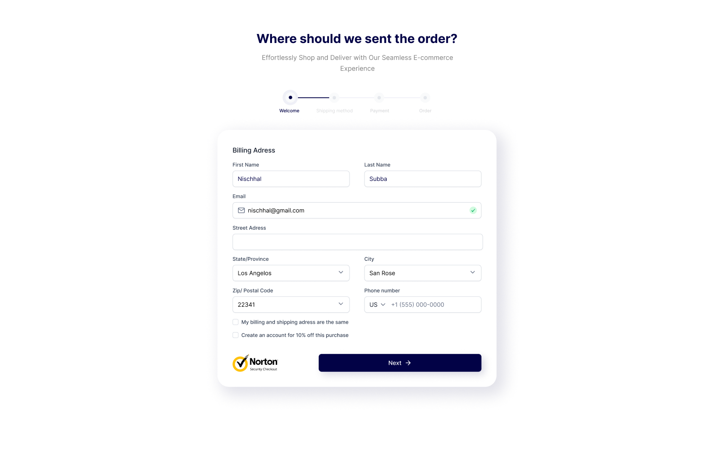
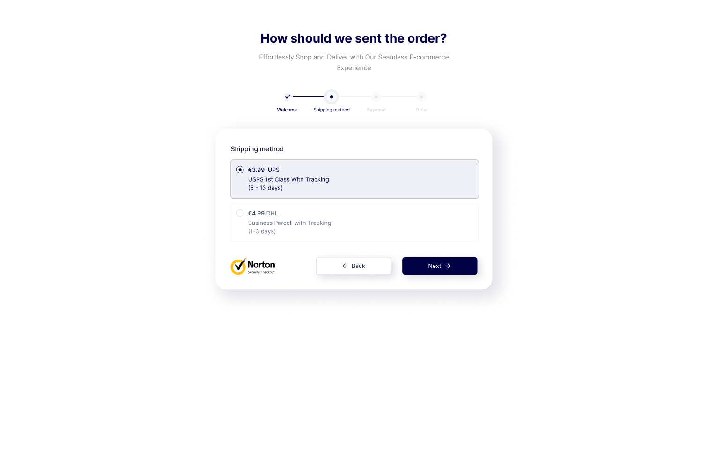
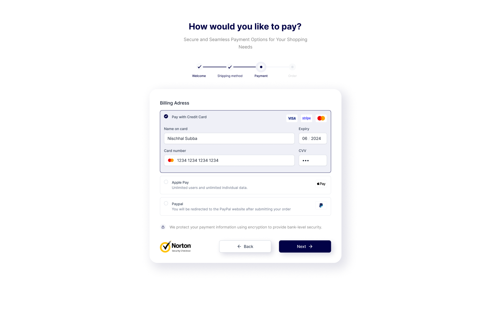
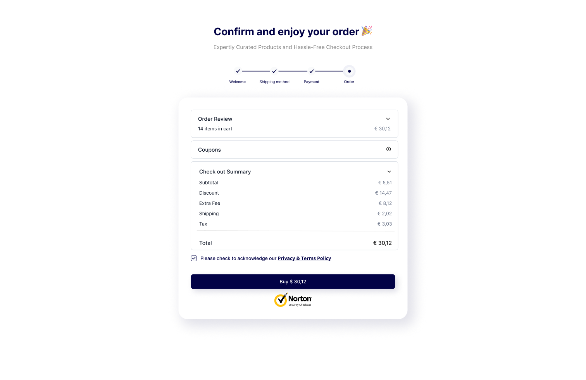
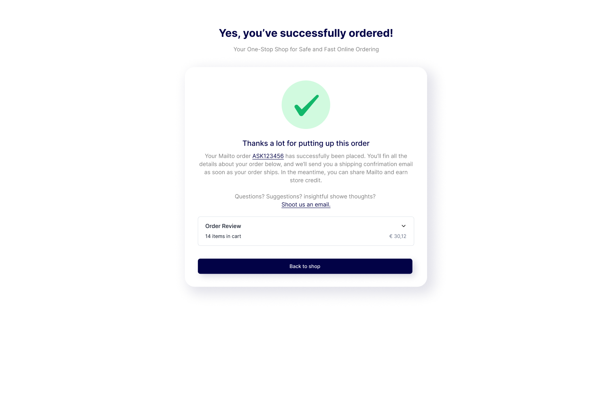
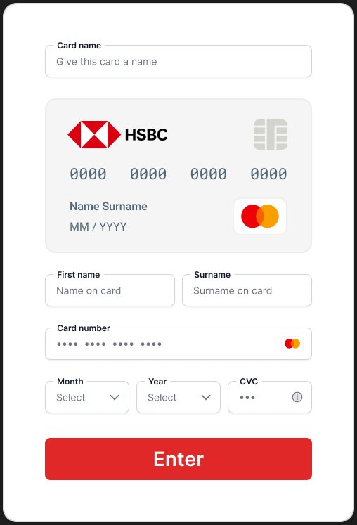

## Overview

This Uxcel accessibility exercise presents an e-commerce payment flow divided into four stages. The published brief is listed as an accessible signup-form exercise, while the submitted work documents checkout; this case study describes the actual submitted checkout design.

## Design challenge

Break a complex transaction into understandable steps so users know what information is required and when they can review the order.

## Flow

1. Welcome: explain the process and set expectations.

1. Shipping: collect delivery details and allow method selection.

1. Payment: gather the payment information needed to complete the purchase.

1. Order: show item, cost, tax and shipping details for review before submission.

## Original checkout interface — screen-by-screen

The original Uxcel submission describes four transaction stages. The original Figma file also contains a fifth screen for successful order confirmation. These are the actual designs, not reconstructed illustrations.

### 01 — Welcome and billing details

The first screen groups customer identity, email, street address, region, city, postal code and telephone in a single billing form. A progress indicator sets expectations for the remaining stages. Persistent field labels and an email status indicator are visible in the original design. For implementation, required fields, address autocomplete, international address formats and validation should be explicitly defined.

### 02 — Shipping method

Two delivery options display price, carrier and estimated delivery duration together, allowing shoppers to compare cost and speed. A selected radio control and highlighted panel indicate the active method. Back and Next actions keep the multi-step flow navigable. A production version should recalculate delivery charges when the method or address changes, preserve selections on Back, and communicate unavailable shipping options.

### 03 — Payment

The selected card-payment panel exposes cardholder, number, expiry and security-code inputs. Apple Pay and PayPal appear as alternative options. The visual separation helps distinguish the active method from available alternatives. These are design mockups; the payment logos, security badges, card values and security statements do not establish an implemented or certified payment integration. A production implementation must use supported secure payment components and explain failures without exposing sensitive information.

### 04 — Order review and purchase

The review screen groups items, coupons and cost breakdown, with a final purchase button and policy acknowledgement. This offers a chance to inspect the transaction before commitment. The historic mockup contains inconsistent sample totals and currency formatting; production totals should be derived from the actual order and verified before payment. Coupon errors and changes in price or availability require explicit recovery states.

### 05 — Order confirmation

The confirmation screen provides a clear success indicator, an order reference, expandable review details, contact access and a return-to-shop action. In production, this state should appear only after authoritative payment and order confirmation. Pending, duplicate, failed and interrupted transactions need separate handling.

### Supporting form exploration — credit card

This original form exploration separates card identification, cardholder details, number, expiration and security code. It is a supporting design artifact rather than an additional stage in the main checkout. Its placeholder values and payment branding are illustrative.

## Design rationale and next iteration

I organized the transaction around one decision at a time: provide details, choose delivery, choose payment, verify the order, then receive confirmation. The recurring progress indicator and consistent navigation pattern support orientation. The original screens provide visual design evidence, not evidence of completed usability or accessibility testing. In a follow-up prototype, test focus order, inactive step contrast, keyboard operation, error announcements, editable review details, responsive reflow and payment recovery. Review sample labels, copy, currency precision and placeholder information before implementation.

[Open the original Figma form-accessibility project](https://www.figma.com/design/8NYbC3D0e3VZqWjiwdZd8m/Uxcel?node-id=33-250)

## Deliverable and validation

The source contains a Figma prototype and style-guide artifacts. The design explores structure and clarity; formal WCAG conformance and usability performance have not been verified. A future review should test keyboard access, accessible labels, error announcements, contrast and focus behaviour.

## Source

[Original Uxcel showcase and full project](https://app.uxcel.com/showcase/form-accessibility-55960)

## Accessibility and interaction design extension

The original submitted work shows a four-stage transaction. Proposed user groups: keyboard-only users, screen-reader users, users with low vision, and shoppers on mobile or slow networks. Main research question: can people understand requirements, complete each step and correct mistakes independently?

## Flow and state specification

Welcome → shipping → payment → order review → confirmation. For every step, specify required and optional labels, input instructions, validation messages, focus movement and preserved input when navigating back. Handle invalid address, unavailable shipping, failed payment, expired session and double submission. Review includes item totals, fees, editable shipping details and explicit final confirmation.

## Proposed accessibility evaluation

Test semantic labels, logical focus order, visible focus, color contrast, zoom/reflow, meaningful error text, error summary links, and announcements for dynamic changes. Use keyboard and screen-reader checks alongside manual and automated accessibility review. Relevant WCAG 2.2 criteria include labels/instructions (3.3.2), error identification (3.3.1), error prevention for financial transactions (3.3.4), keyboard access (2.1.1), contrast (1.4.3) and focus visible (2.4.7). Reference: [https://www.w3.org/TR/WCAG22/](https://www.w3.org/TR/WCAG22/). This is a proposed test checklist, not a conformance claim.

## Measurement

Record completion and error recovery by task and interaction method; chart observed failures by stage with counts and sample size. Treat accessibility blockers as defects requiring remediation regardless of frequency. No audit results are available.

## Supporting research visuals

