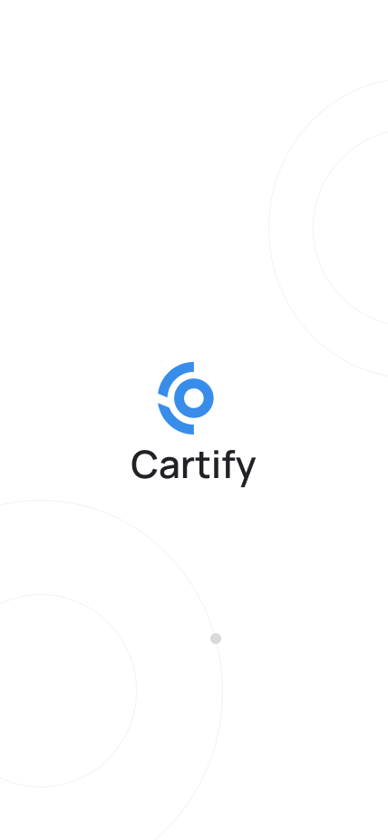
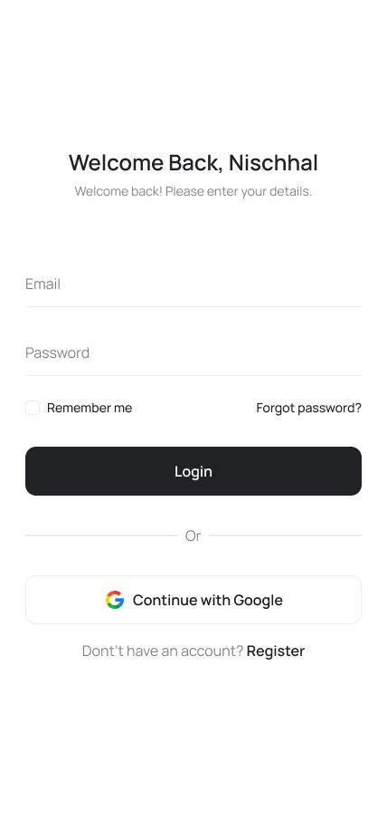
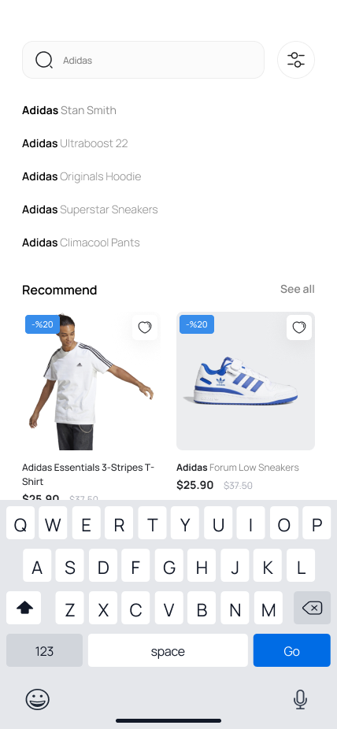
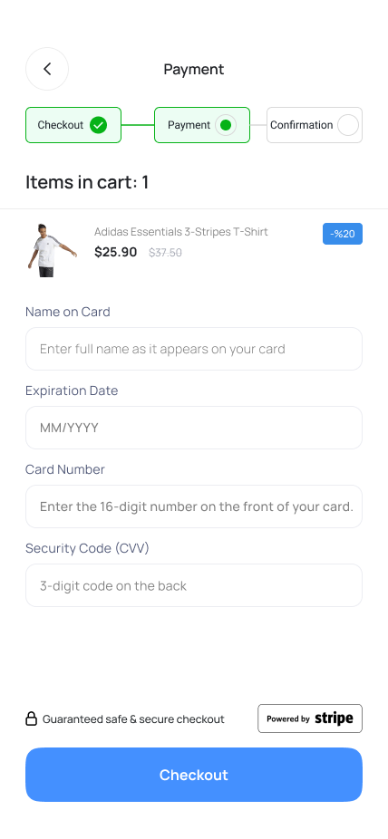
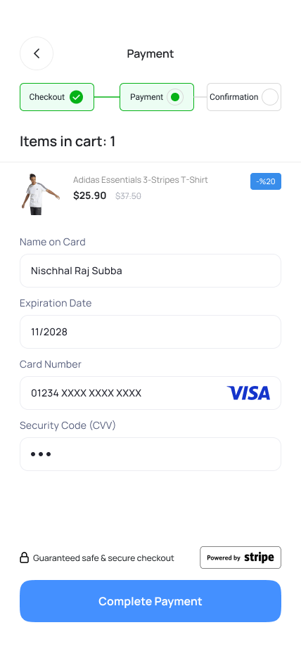
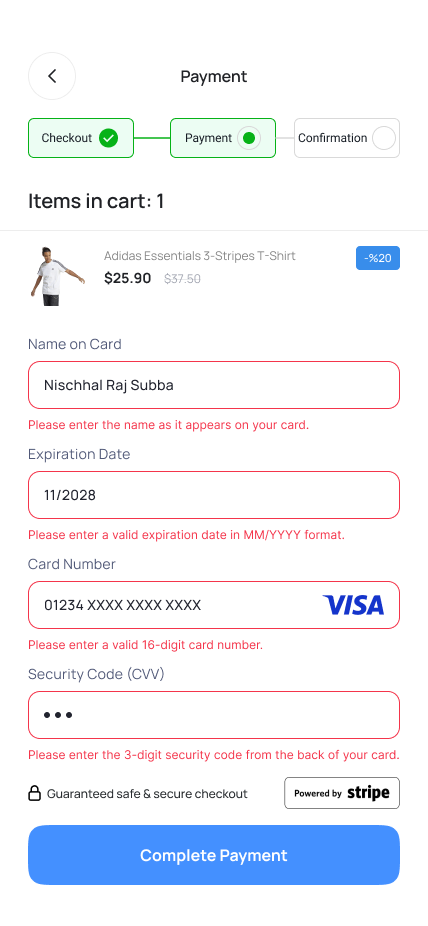
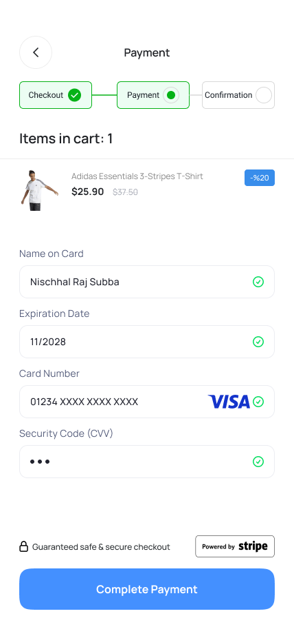
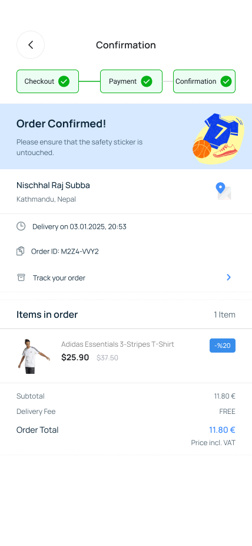

## Overview

Cartify is a mobile shopping concept created for a Uxcel checkout design brief. I explored the full journey rather than designing an isolated payment screen.

## Flow and design rationale

- Entry: branded splash screen, account access, registration and recovery options.

- Discovery: promotional home, familiar bottom navigation, search history, filters and consistently structured product cards.

- Evaluation: product detail information supports an informed purchase.

- Checkout: a progress indicator, recognizable payment options, promo code entry and visible total clarify the transaction.

- Payment and recovery: clear card-field labels and validation communicate input requirements.

- Post-purchase: order details, confirmation and a delivery timeline support reassurance and tracking.

## Feedback and next iteration

Uxcel peer feedback identified improvements to stepper alignment, payment-method coverage, promo-code discoverability and card-security messaging. These are documented iteration opportunities, not verified fixes.

## Deliverable

A multi-screen Figma design demonstrating transaction clarity and consistent interaction patterns. Reduced abandonment is a design hypothesis, not a measured result.

## Source

[Original Uxcel showcase and full project](https://app.uxcel.com/showcase/cartify-decision-making-process-and-rationale-479)

## UX strategy extension

Primary jobs: find a suitable product, compare price and availability, complete a trustworthy payment, then know when an order will arrive. Hypothesized segments include goal-directed shoppers and exploratory browsers. Research prompts: where do shoppers lose confidence, what information is needed before adding to cart, and how do they recover from a failed payment?

## Journey and decision map

Discover → search/filter → product detail → cart → payment → confirmation → tracking. At each stage define the next action, required information, possible failure and recovery route. Proposed edge cases include empty search, unavailable size, invalid promo code, changed price, network loss, declined payment, duplicate submission and delayed delivery. Prevent duplicate charges through engineering-side idempotency; show status and retry guidance rather than implying success prematurely.

## Validation plan and visualization

Moderated tasks: find a product with a filter; compare the final price including delivery; apply a promo code; recover from a payment decline; locate tracking. Record task success, first critical error, time and post-task ease. Use a funnel chart of actual unique users progressing through product view, cart, checkout and order confirmation; use a separate failure-reason chart for observed checkout errors. Analyze by device and new/returning customer where consent and data quality permit. No conversion or abandonment results are available.

## Iteration and handoff

Prioritize payment errors and clarity of totals before visual polish. Define loading, disabled, empty, error and success states; specify input semantics, focus and accessible payment validation. Peer feedback described in the original project provides formative critique; implementation and impact are not verified.

## Supporting research visuals

## Original screens: the shopping journey

### Entry: branded splash

The opening frame uses a centered wordmark and restrained circular graphics to establish identity without competing with the next action. In implementation, keep startup brief and provide an accessible loading or recovery state if initialization stalls.

### Account access: empty login

Email and password entry, a remember-me choice, password recovery, registration and an alternative Google sign-in route are visible. Persistent labels, stronger input boundaries, password visibility and accessible validation are proposed refinements. The original filled login also exists in Figma; it is omitted from this update pending confirmation of its example email.

### Discovery: home

A search field, filter entry point, promotional hero and product cards provide multiple discovery routes. Cards present product images, pricing and favorites without requiring the shopper to open each detail page. The bottom navigation maintains access to the shopping bag and account.

### Discovery: active search

The active search displays matching query suggestions, a filter control, recommended products and the on-screen keyboard. Bold query prefixes support scanning. Keep the selected suggestion and search text consistent when navigating back; define loading, empty and network-error states in production.

### Comparison: product grid

The category screen uses a repeated two-column layout with comparable product metadata, search and sort controls. For implementation, retain query and filter state when users return from a product detail, and communicate no-results and unavailable-product states.

### Product evaluation: details

The product detail prioritizes photography, product identity, ratings, price, description and size selection. The purchase action and total price stay close together. The historical mockup highlights two sizes at once; for a single-variant purchase, define one selected size and distinguish availability from selection. Example reviews, prices and discounts are mock data.

### Checkout: payment decision and cost review

The stage indicator separates checkout, payment and confirmation. Payment choices and the promo-code entry precede the cost breakdown and checkout action. This keeps item cost and shipping visible before commitment. In a production specification, use consistent currency precision, explain discount calculation, and prevent duplicate payment submission. External payment methods require supported integrations and recovery flows.

### Payment: empty card form

The stepper identifies Payment as active while the product summary keeps purchase context visible. Cardholder name, expiry, card number and security code each have a dedicated field and guidance. The Stripe mark is part of the historical concept, not evidence of an implemented integration. Production inputs should accommodate supported card formats, autofill and accessible labels.

### Payment: entered details

This state shows entered example details, masked security code, card-brand treatment and a more explicit Complete Payment action. It demonstrates the transition from an empty form to a populated one, not a completed transaction. A real implementation should avoid storing sensitive card data in the app and distinguish local validation from payment authorization.

### Payment: validation errors

Red outlines and field-level messages show where corrections are required. The historical mockup applies errors to multiple populated fields as a demonstration, so its examples should not be taken as actual validation rules. In production, use meaningful error text, programmatic error associations and focus management; do not rely on color alone.

### Payment: input validation feedback

Check icons beside the populated fields depict positive input feedback. This is separate from successful payment: the app should only advance after the payment provider returns a verified outcome. Define processing, decline, retry and duplicate-submission prevention states.

### After purchase: confirmation

The completed stepper, confirmation banner, delivery details, order reference and tracking link establish the next steps. The order summary shows an item price and total in different currencies in this historical mockup; a production design should reconcile the totals and currency before confirmation. Order details and payment values are illustrative, not evidence of a real sale.

### After purchase: delivery information

The original overlay groups status entries around an order identifier. The mock dates are not chronologically consistent; a production version should derive status order from verified event timestamps, distinguish current and completed steps, and accommodate delays and failed delivery.

## Proposed validation and handoff

Ask users to find a sportswear product, choose a size, explain the total cost, choose a payment option and locate delivery progress. Measure task completion, errors, first-click accuracy and confidence. Include tests for screen-reader labels, touch targets, discount clarity, empty cart, declined payment, retry, price changes and unavailable variants. These are proposed tests and implementation considerations, not completed research or live product results.

[Open the original Figma shopping flow](https://www.figma.com/design/8NYbC3D0e3VZqWjiwdZd8m/Uxcel?node-id=237-312)