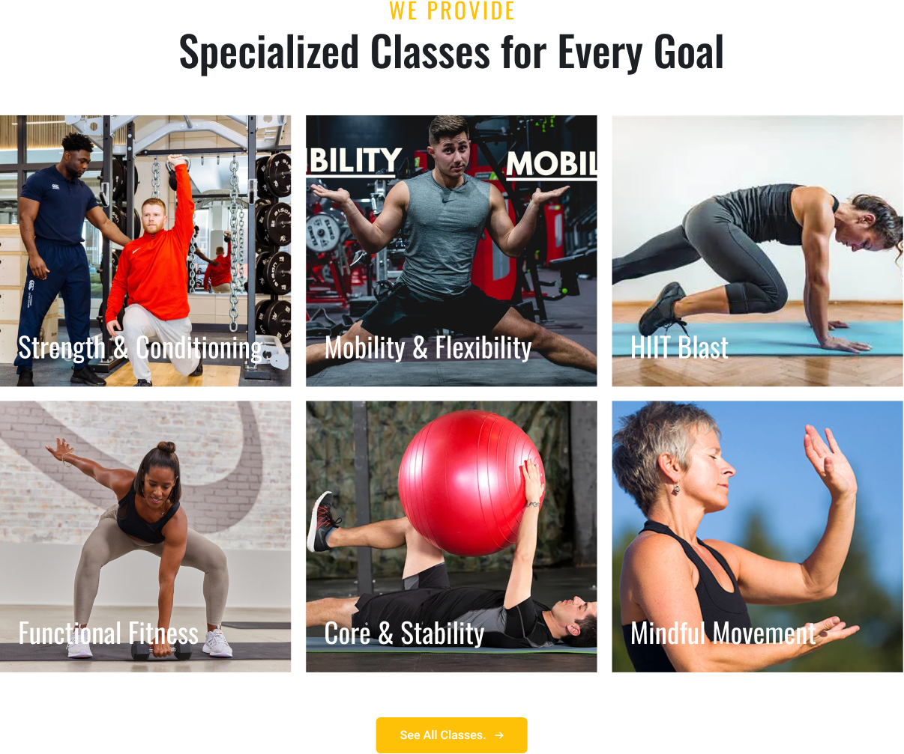

## Overview

CoreFit is a fitness-studio landing page concept developed for a Uxcel design brief. It explores how a fitness brand can guide prospective members from discovery to joining.

## Challenge

Make training options, expert coaching and the community proposition clear to both newcomers and experienced athletes, while giving visitors an obvious next step.

## Design approach

- Lead with a high-impact hero and a primary membership CTA.

- Establish credibility with coach profiles and class information before presenting offers and newsletter signup.

- Use energetic yellow accents against black and white; pair condensed Oswald headings with readable Roboto body text.

- Support scanning through concise benefit-led copy, consistent spacing and action-oriented photography.

## Original landing page — section-by-section

### Hero and first decision

The hero introduces the fitness offering through a prominent headline, supporting copy and trainer imagery. Join Now and Explore Program distinguish visitors ready to act from those still evaluating options. The discount is illustrative concept copy, not a verified promotion.

### Training introduction

The darker introduction separates the brand proposition from the opening section. Photography, a concise heading and a supporting quote establish the intended tone. The experience claims and named example testimonial require verification before real-world publication.

### Trainer profiles

The three trainer cards pair portraits with names and specialties. This helps visitors compare the types of support available without reading long biographies. In production, verify identities, credentials and photography permissions, and ensure the image-overlay text maintains sufficient contrast.

### Class catalogue

The class grid uses distinct photographs and short labels to help visitors identify relevant activities, including strength, mobility, HIIT, functional fitness, core stability and mindful movement. The catalogue action offers a route to explore more options. A future version could clarify schedules, difficulty, availability and booking requirements.

## Proposed decision journey and handoff

Understand the offer → evaluate training support → compare classes → explore the program or begin joining. Test whether visitors understand the difference between the primary and secondary actions, can find a relevant class and know what to expect next. Specify responsive image crops, readable text over photography, keyboard access, accessible control names and form feedback. These are proposed tests and implementation requirements, not verified conversion improvements.

[Original Figma landing page](https://www.figma.com/design/8NYbC3D0e3VZqWjiwdZd8m/Uxcel?node-id=258-241)

## Deliverable and validation

The deliverable is a landing page design, not a deployed campaign. Conversion improvement is an intended goal, not a measured result. A future test could assess CTA discovery, membership inquiries and form completion.

## Original project

[Uxcel showcase and full design rationale](https://app.uxcel.com/showcase/corefit-arena-a-high-converting-landing-page-design-for-fitness-enthusiasts-090)

## Product strategy extension

Target segments (hypotheses): beginners seeking guidance, experienced athletes comparing programs, and time-constrained prospects assessing schedule and location. Key job: decide whether the studio is relevant, credible and practical before committing. Research questions: can a first-time visitor describe the offering, locate appropriate classes and identify the membership next step? Which missing details prevent a decision?

## Information architecture and decision journey

Discovery → value proposition → class/program comparison → trainer credibility → offer/CTA → inquiry. The hero serves recognition; class cards support relevance; trainer information reduces uncertainty; repeated CTA placement supports action after evaluation. This is an analytical reading of the existing design, not observed user behaviour.

## Proposed validation

Recruit a mix of beginners and experienced exercisers. Run first-click tests for finding a beginner class, understanding what membership includes and locating the join action. Compare a CTA-first hero against a program-first alternative, holding traffic source and offer constant. Check mobile reading order, contrast, keyboard access and form labels. Track CTA discovery, inquiry completion and time to find class information. A funnel chart would use unique eligible visitors at each sequential event (landing view, class detail, membership CTA, inquiry completion); report conversion as completed inquiries / eligible landing visitors. No conversion data has been supplied.

## Handoff and trade-offs

Prioritize a clear primary CTA over competing newsletter prompts; maintain typography and spacing consistency, avoid decorative text baked into images, specify responsive behavior and focus states. The design is a concept: validation and implementation remain proposed.

## Supporting research visuals

