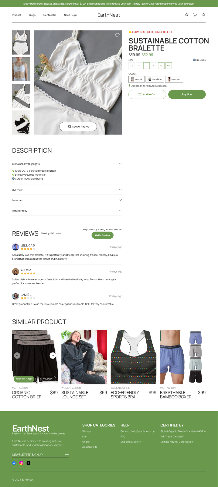

## Overview

Earthnest is an independent e-commerce design exercise for sustainable apparel. The original product-page design presents a sustainable cotton bralette, with product photography, size and color options, reviews, materials and return information.

## Design challenge

Help a shopper evaluate fit, material claims and purchase conditions without leaving the product page. Make key purchase information easy to compare without overwhelming the visual hierarchy.

## Design rationale

- Product photography and a gallery affordance support close evaluation.

- The size guide and XS–XXL choices address fit uncertainty.

- Material, sustainability and return-policy sections make supporting information discoverable.

- Price, availability, variant selection and purchase actions are grouped together; reviews and related products support later evaluation.

- Sustainability statements, stock counts, prices and testimonials in the original mockup are illustrative, not verified claims about a real business.

## Original design

[View original Figma design](https://www.figma.com/design/8NYbC3D0e3VZqWjiwdZd8m/Uxcel?node-id=335-287)

## Proposed research and validation

Ask shoppers to find a size, explain the material claims, identify return conditions, and choose a variant. Compare task success, first-click accuracy and confidence. Check keyboard access, visible focus, contrast, screen-reader labels and color-independent variant selection. Validate certification claims before implementation. No measured conversion or usability results are available.

## Product evaluation journey

### Discover and assess
The product gallery occupies the primary visual area, giving shoppers multiple angles before they commit to a variant. A thumbnail strip and a gallery action communicate that more product imagery is available. The adjacent title, price and stock message make the purchase context visible without requiring a separate details screen.

### Choose the right product
Size options, size guide and color swatches are grouped immediately above the purchase actions. This arrangement is intended to support comparison and reduce uncertainty about fit. The original concept also includes an accessibility-of-features label. Its meaning and evidence would need clarification before a production release.

### Evaluate trust and purchase conditions
Expandable sections for sustainability, overview, materials and returns progressively disclose supporting information. Reviews provide a separate evaluation layer and related products support further exploration. All certification, stock, price, review and environmental claims in the artwork are fictional examples, not verified merchant claims.

## Design decisions and trade-offs
- A two-column desktop hierarchy separates imagery and purchase controls; a narrow layout should retain the same decision order.
- A compact accordion reduces initial information density, but essential fit and return details should remain easy to locate.
- Variant controls must communicate selected, unavailable and error states without color alone.
- Add-to-cart should communicate missing required selections, inventory changes, and network recovery. These are proposed implementation states rather than evidence of delivered screens.

## Proposed validation questions
1. Which size would you choose, and where would you check fit? Evaluate size-guide discovery and comprehension.
2. What evidence would you need to trust the sustainability claim? Evaluate claim clarity and supporting information.
3. What happens if the item is not suitable? Evaluate return-policy discoverability.
4. Can you select a different color and explain the active variant? Evaluate state clarity.
5. What would you expect after Add to Cart versus Buy Now? Evaluate action expectations.

Measure task completion, errors, information-finding time and confidence. Check keyboard focus, semantic button labels and non-color variant indicators. The outcome is a product-page concept; no verified commercial results are available.