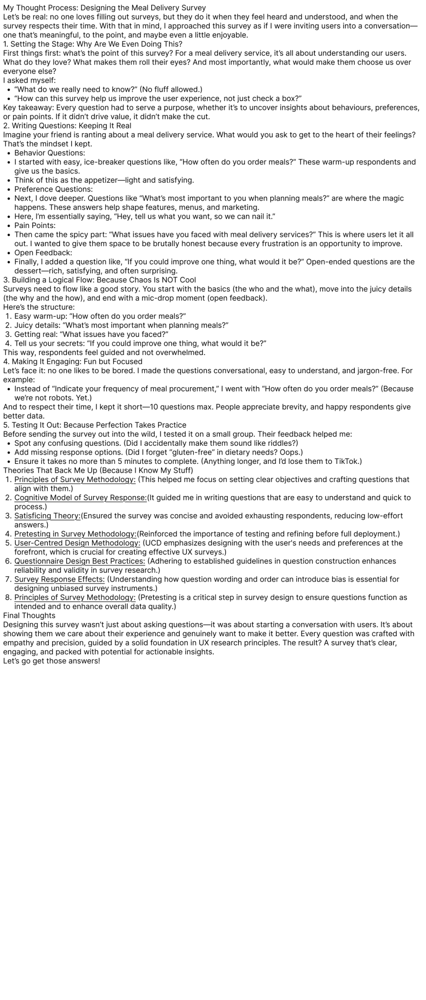

## Research objective

This Uxcel exercise explores how a meal delivery service can understand ordering frequency, dietary preferences, decision factors and recurring frustrations before making product changes.

## Method and design decisions

I structured a short questionnaire to move from straightforward behaviour questions to preferences, pain points and open feedback. Plain language and a conversational tone reduce respondent burden. The questionnaire was designed for a maximum of ten questions and a completion time of approximately five minutes.

## Refinement

The original write-up describes a small pretest to identify ambiguous wording and missing dietary options. The sample size and raw responses are not published, so I treat this as survey-design evidence rather than representative research findings.

## Deliverable

A structured research questionnaire using Typeform and Google Forms. Its intended value is to inform feature priorities, menus and service improvements. No survey findings or business impact are claimed here.

## Next validation

Run the questionnaire with an appropriate participant sample, analyze response patterns and follow up with interviews.

## Source

[Original Uxcel showcase and full project](https://app.uxcel.com/showcase/meal-delivery-service-ux-research-survey-815)

## Original survey-design evidence

The original Figma write-up records the reasoning behind the questionnaire sequence: start with ordering behaviour, ask about preferences, explore pain points and finish with open feedback. Its four documented example prompts are:

- How often do you order meals? — establish behaviour with a low-effort opening question.
- What's most important to you when planning meals? — identify preferences that could inform menu and feature priorities.
- What issues have you faced with meal delivery services? — surface friction without assuming which issue is most important.
- If you could improve one thing, what would it be? — capture unanticipated improvements in the respondent's own words.

The source also describes a small-group pretest, checking confusing wording, missing response options such as gluten-free, and a five-minute completion target. It references cognitive survey response, satisficing, pretesting, user-centred design and response effects. These are documented design choices; the complete questionnaire, participant count, responses and quantitative findings remain unverified. The ten-question follow-up below remains a proposed expansion rather than the original instrument.

[View the original Figma methodology](https://www.figma.com/design/8NYbC3D0e3VZqWjiwdZd8m/Uxcel?node-id=441-149)

## Expanded research framework (proposed follow-up)

Decision to support: whether to improve meal discovery, delivery reliability, pricing transparency or dietary personalization first. Recruit recent delivery customers, occasional users and people who have stopped ordering; include different dietary needs and budgets. Screen for experience, not demographic stereotypes. Participation is voluntary; avoid collecting addresses, health diagnoses or payment information.

## Complete expanded questionnaire

The original showcase documents the questionnaire strategy and gives examples of questions. The complete Typeform is unavailable, so the following is an expanded proposed instrument, not a verbatim transcript of the original. Aim for approximately five minutes. 

1. In the past 30 days, how often have you ordered a meal for delivery? (Never; 1–2; 3–5; 6–10; 11+.) Why: establishes recent behaviour rather than intention and enables comparison between occasional and frequent customers. Decision: segment subsequent findings.

1. When do you typically order delivered meals? (Weekday lunch; weekday dinner; weekends; late nights; special occasions; other; not applicable; multiple selections.) Why: identifies context and time constraints. Decision: meal scheduling, availability and delivery estimates.

1. What is most important when you choose a meal delivery service? (Select up to three: total cost, delivery time, food quality, menu variety, dietary fit, reliability, convenience, other.) Why: forces meaningful prioritization instead of asking whether every factor matters. Decision: value proposition and backlog.

1. Which dietary preferences or restrictions should a service accommodate? (No specific preference, vegetarian, vegan, halal, allergy-related ingredient avoidance, other, prefer not to answer; multiple selections.) Why: identifies menu and filter requirements without collecting medical records. Decision: ingredient transparency and accessible filters.

1. How easy or difficult was it to find a suitable meal on your most recent order? (Very difficult / difficult / neither / easy / very easy / not applicable.) Why: measures perceived discovery effort in a specific experience. Decision: search, categories and recommendation design.

1. On your most recent order, which problems did you encounter, if any? (Unexpected fees, inaccurate ETA, late delivery, unavailable meals, unclear ingredients, payment issues, order errors, other, none; multiple selections.) Why: anchors pain points in recent behaviour and avoids assuming a negative experience. Decision: prioritize failure recovery and operational fixes.

1. How clear was the total price before you placed your most recent order? (Very unclear to very clear; not applicable.) Why: isolates fee transparency from general satisfaction. Decision: cart pricing, delivery fee disclosure and promotions.

1. What was the biggest reason you abandoned or decided against a meal delivery order in the past 30 days? (Cost, delivery time, unavailable suitable meal, trust, app complexity, payment issue, other, did not abandon, did not attempt.) Why: includes customers whose unmet needs never appear in successful-order analytics. Decision: identify abandonment drivers.

1. If you could improve just one part of the service, what would you choose? (Menu discovery, meal information, pricing, checkout, delivery tracking, support, other.) Why: converts broad feedback into a forced improvement priority. Decision: rank candidate initiatives against Q6 and Q8.

1. Is there anything else you wish a meal delivery service understood about your experience? (Optional open text.) Why: surfaces unanticipated needs without steering answers. Decision: identify themes for follow-up interviews.

## Analysis and graph plan

Use a horizontal bar chart for Q3 priorities and Q6 reported problems; multiple-choice percentages are respondents selecting each option / respondents answering that question, so totals may exceed 100%. Use a 100% stacked bar for Q5 and Q7 ease/clarity by ordering frequency, with group counts shown. Use a bar chart for Q8 abandonment reasons and Q9 improvement priorities. Code Q10 into themes with anonymized examples and retain minority viewpoints. Report denominators, missing responses, recruitment limitations and survey completion rate; avoid inferring causation from correlations.

Research-to-design pathway: recruit → screen → pilot wording → collect responses → clean and segment → visualize → prioritize → test prototypes. A small cognitive pilot can uncover ambiguous options and confusing skip logic before distribution. No numerical results or respondent counts are available; these charts are specified, not populated with invented data. 

## Supporting research visuals

