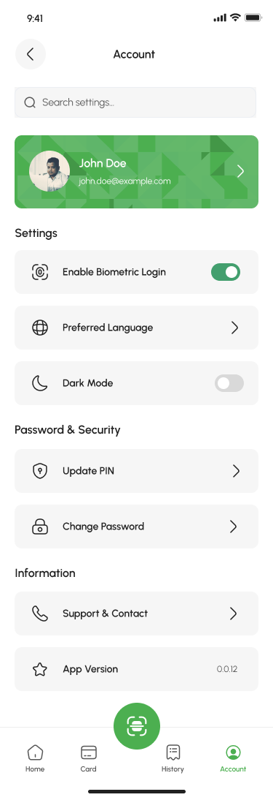
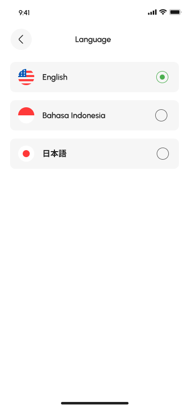
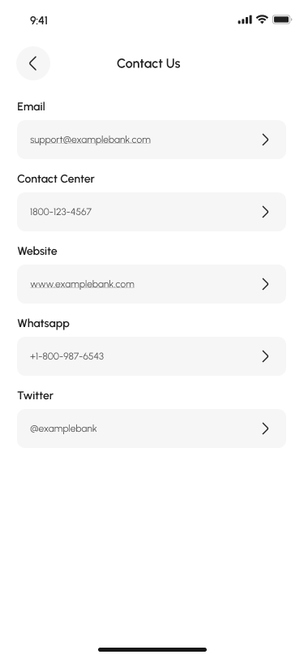

## Overview

This independent mobile settings exercise explores an example banking app's account settings, preferred language and contact support. Three original Figma screens show an account page, language selection and support contact information.

## Design challenge

Make frequently used preferences, security controls and help channels easy to locate while keeping sensitive account actions understandable.

## Design rationale

- The account screen separates preferences, password and security, and information. Search provides an alternate route to settings.

- Biometric login and dark mode use toggle controls; preferred language opens a dedicated selection screen.

- Language options include English, Bahasa Indonesia and Japanese, with a visible selection indicator.

- Support channels are grouped in one destination rather than scattered across unrelated screens.

- Example account details and contact information are mock data, not real customer information.

## Original screens

[View original Figma screens](https://www.figma.com/design/8NYbC3D0e3VZqWjiwdZd8m/Uxcel?node-id=446-2)

## Proposed validation and handoff

Ask users to change language, locate security settings, identify the active preference and find an appropriate support channel. Record task success, navigation errors and confidence. Specify authentication requirements for sensitive actions, confirmation and recovery, localization, accessible labels and focus behavior. No measured usability results are available.

## Decision journey and interface design

### 1. Account and settings discovery

The account screen establishes a single starting point. Search provides an alternative to scanning categories, while separate preference, security and information groups reduce the need to interpret a long list. Toggle controls signal immediate binary preferences; chevrons indicate destinations requiring more detail. The persistent account tab identifies the active area.

### 2. Language selection

The focused selection screen reduces competing actions. Language labels use their native names alongside visual markers, and the selected radio indicator communicates the current choice. A production version should not rely on flags alone to represent language; it should announce selection to assistive technology and accommodate longer translated labels.

### 3. Contact and support

A dedicated support destination makes available channels discoverable without mixing them with security settings. Contact information is illustrative mock data. A production design should explain external handoffs, provide a copy action, and handle unavailable channels gracefully.

## Design decisions, trade-offs and proposed edge cases
- A single account hub minimizes navigation depth, but search quality must be tested as settings grow.
- Immediate toggles should communicate saving, success and failure; biometric setup may require device authentication and permission recovery.
- PIN and password changes require authenticated confirmation and recovery paths. These behaviors are recommendations, not additional delivered screens.
- Language changes should preserve the current preference if saving fails. Check right-to-left layout, text expansion, focus order and non-color selection indicators.

## Proposed research questions and evaluation
1. Where would you change the app language? This tests discoverability and terminology.
2. How do you know which language is currently active? This evaluates selection feedback.
3. Where would you go if you forgot your PIN? This distinguishes settings discovery from account recovery.
4. Which support channel would you choose, and why? This tests whether the destination supports real help-seeking behavior.

Record first-click accuracy, task completion, navigation errors and confidence, and test with screen-reader and larger-text settings. The deliverable is the three original concept screens; no live deployment or measured usability improvement is documented.