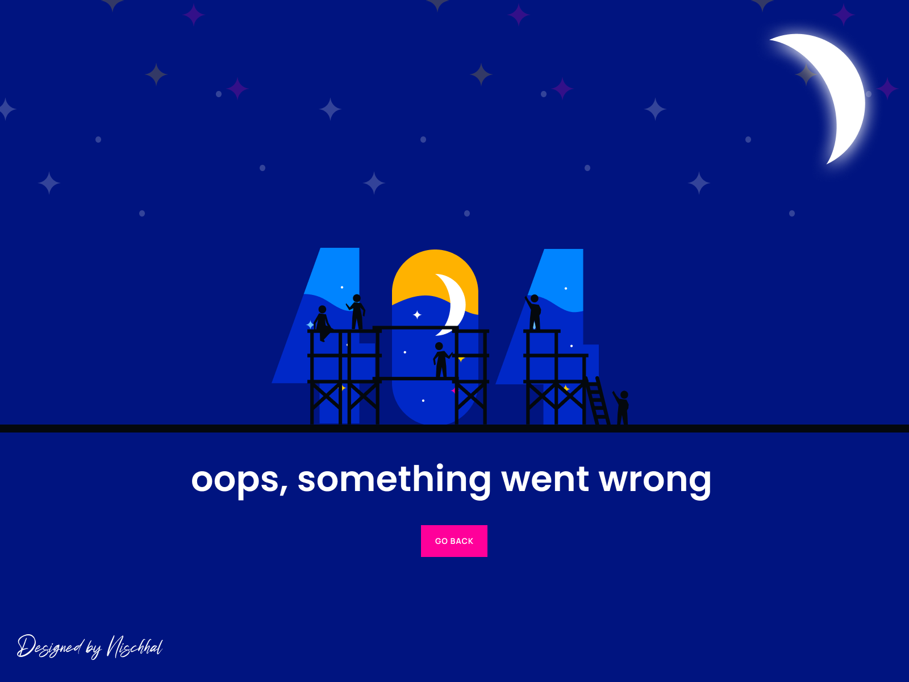

## Overview

A Uxcel design brief exploring how a neobank can make a missing-page experience helpful, recognizable and less frustrating.

## Problem and design rationale

The design aims to maintain PiggyBank's approachable brand while guiding people back to a useful destination. Non-technical, non-blaming copy explains the problem; home, help and contact routes provide recovery options. Search is part of the proposed recovery strategy. A playful illustrated error state softens the interruption.

## Original 404 interface

The full screen shows a night-sky illustration, a large construction-themed 404 motif, a direct error message and a contrasting Go Back action. The illustration introduces a playful tone, while the action provides a clear visual focal point. This is the actual independent design exercise, not a screenshot of a deployed error page.

## Recovery approach and design limitations

The intended journey is to recognize the problem, understand that the requested page is unavailable, and return to a useful destination. The current wording is generic; a future iteration should explicitly explain that the page was not found. Go Back needs a defined fallback for visitors who arrived directly or from an external site. A home or search route could provide alternative recovery where appropriate.

Test whether users recognize the error, identify the recovery action and reach the intended destination. Verify keyboard focus, accessible button labeling, text contrast and responsive behavior. The original visual deliverable demonstrates the concept; no live recovery or usability results have been measured.

[Original Figma 404 screen](https://www.figma.com/design/8NYbC3D0e3VZqWjiwdZd8m/Uxcel?node-id=432-1374)

## Peer feedback

Uxcel reviewers identified concrete opportunities: improve CTA and search contrast, make the main recovery action clearer, reduce navigation height, bring explanatory copy and search into the page body, and refine the illustration.

## Deliverable and next steps

The original Figma/Illustrator concept demonstrates error-state design and UX writing. Feedback is recorded as an iteration backlog rather than claiming revisions were completed. Accessibility checks and user testing remain necessary before implementation.

## Source

[Original Uxcel showcase and full project](https://app.uxcel.com/showcase/404-error-page-53535)

## UX research and recovery strategy extension

A missing page is a failure-recovery moment, especially in a financial product where customers may be worried about account access. Hypothesis: concise, non-blaming copy and a clearly prioritized safe destination can reduce confusion. Test with new visitors and returning customers navigating to help, account or product information.

## Recovery flow

Missing URL → clear explanation → primary return-home route → secondary help/search/contact → useful destination. Proposed edge cases: signed-in expired sessions, mistyped deep links, outdated support URLs, unavailable search results, and mobile navigation. Do not ask for credentials or sensitive financial data on an error page.

## Test plan

Give participants a task to find help after following a broken link. Compare a single primary recovery action with a version offering several equally prominent actions. Observe first click, successful recovery, time and comprehension. Test contrast, zoom, focus order, keyboard navigation and screen-reader announcements. Keep the illustration subordinate to the recovery actions.

## Measurement and iteration

After implementation, instrument 404 views, recovery clicks, successful destination loads and exits, excluding automated traffic and repeated events where appropriate. A recovery funnel would show observed event counts and the share reaching a useful destination. Use source peer critique to prioritize CTA prominence and contrast; there are no measured recovery rates or implemented outcomes.

## Supporting research visuals

