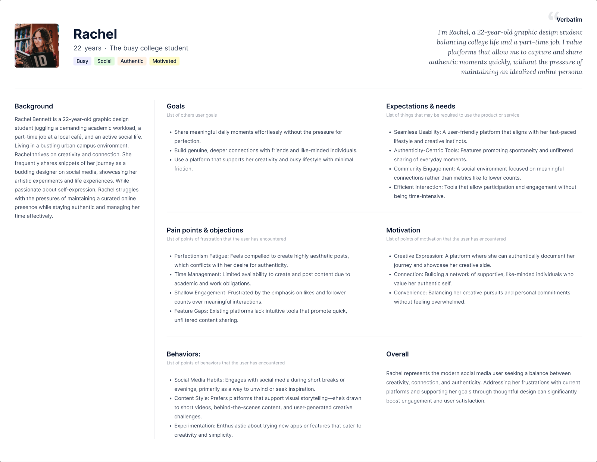

## Overview

This independent persona-design exercise explores a social media audience through Rachel, a hypothetical 22-year-old graphic design student with a part-time café job. The original persona describes a busy schedule and a desire to capture and share moments without pressure to present a perfect image.

## Design challenge

Translate a broad social-sharing problem into a useful design lens: support low-effort, authentic posting within a busy daily routine.

## Persona rationale

- Background establishes the context in which social sharing happens.

- Goals and motivations help prioritize meaningful interactions rather than engagement for its own sake.

- Pain points and objections identify friction to investigate in posting, discovery and self-presentation.

- Expectations, needs and behaviors connect the persona to future interaction decisions.

## Original persona

[View original Figma persona](https://www.figma.com/design/8NYbC3D0e3VZqWjiwdZd8m/Uxcel?node-id=274-6886)

## Proposed validation

Interview students balancing study and work about recent sharing behavior, time constraints, privacy and pressure to curate posts. Ask what they wanted to share, what stopped them and how they recovered. Observe a lightweight posting task and compare perceived effort and confidence. Treat the persona as a working hypothesis; no participant sample, transcripts or validated research findings are available.

## Original persona and evidence boundaries

The persona describes a hypothetical student balancing graphic design studies, part-time work and social commitments. Its stated goals include effortless sharing, authentic connections and a platform that supports creative activity without taking too much time. The persona also describes perfectionism fatigue, time constraints, shallow engagement and a desire for simpler sharing tools. The original first-person statement is part of the fictional persona artifact, not a verified participant quotation.

## From persona to product hypotheses

### Motivation: authenticity
A lower-pressure publishing experience could reduce the perceived need to curate a perfect post. A possible design direction is a simple capture-and-share flow with optional editing rather than mandatory customization.

### Motivation: convenience
Short breaks and evening use suggest a need for a quick entry point, reliable drafts and clear recovery when an upload is interrupted.

### Motivation: meaningful connection
A possible design direction is to emphasize relevant conversations and interaction quality instead of requiring users to optimize for follower counts. These are hypotheses to explore, not implemented features or validated user findings.

## Proposed journey
A student notices a moment worth sharing → captures it → decides whether to edit or publish → chooses an audience → shares → receives feedback. Possible friction includes time pressure, uncertainty about audience visibility and concern about appearance.

## Proposed interview guide
1. Tell me about the last time you wanted to share something but decided not to. Investigates behavior rather than hypothetical preference.
2. What parts of creating a post take the most time? Identifies workflow friction.
3. How do you decide who should see a post? Investigates privacy expectations.
4. What makes an interaction feel meaningful? Explores goals beyond engagement counts.
5. What happens when you are interrupted while posting? Tests the need for save-and-resume behavior.

## Validation and limitations
Recruit people with comparable study and work commitments, compare recurring behaviors, and revise or split the persona when evidence conflicts. Observe a posting task and assess completion, confidence and perceived effort. A possible product should also support accessible controls, audience confirmation and recovery from failed uploads. The delivered artifact is an independent persona exercise; no interview sample, transcripts, production design or measured results are documented.