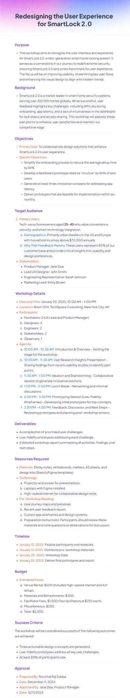

## Overview

This Uxcel leadership exercise documents a proposed redesign workshop for a smart-home locking system. It is a facilitation plan, not evidence of an engagement with a deployed SmartLock product.

## Problem framing

The scenario describes setup friction, latency and difficulty understanding lock status and shared access. The primary audience is technology-comfortable homeowners who value convenience and security.

## Workshop design

The proposed agenda moves from shared research context into collaborative ideation and low-fidelity prototyping. Product, design, engineering and marketing perspectives are represented in the plan. Preparation includes reviewing personas, journey maps, user feedback and existing wireframes.

## Intended deliverables

A prioritized list of challenges, proposed onboarding and dashboard prototypes, and a report capturing decisions and recommendations.

## Success criteria

The brief sets goals for 30% faster setup, a 90% intuitive-dashboard rating, three latency concepts and implementation feasibility. These are planning targets, not achieved metrics. The plan also outlines logistics, responsibilities and a budget.

## Next step

Validate the concepts with actual participants and record usability and feasibility evidence.

## Source

[Original Uxcel showcase and full project](https://app.uxcel.com/showcase/redesigning-the-user-experience-for-smartlock-20-049)

## Original workshop plan and facilitation evidence

The recovered Figma document is the actual planning artifact from the exercise. It sets out purpose, scenario background, objectives, audience, stakeholder roles, a workshop agenda, deliverables, resources, timeline, budget and success criteria. The company and stakeholder details belong to the hypothetical brief; they are not independently verified client facts or approvals.

The proposed January 20, 2025 agenda allocates 10:00–10:30 to introduction, 10:30–11:30 to research context, 11:30–1:00 to ideation, 1:00–2:00 to lunch, 2:00–3:30 to low-fidelity prototyping and 3:30–4:00 to critique and next steps. The plan lists two facilitators, four designers, two engineers, three stakeholders and one observer. These are planned roles and time allocations, not actual attendance or workshop outcomes.

The planned budget is $2,500: $500 venue, $300 materials and refreshments, $1,500 facilitator fees and $200 miscellaneous. Pre-work includes reviewing personas, journey maps, feedback, wireframes and the existing design system. The intended outputs are prioritized challenges, low-fidelity prototypes and a decision report. The document proposes feasible implementation within six months; actual implementation was not verified. The bottom success-criteria line is clipped in the original source, so its incomplete wording is not extrapolated.

[View original workshop planning artifact](https://www.figma.com/design/8NYbC3D0e3VZqWjiwdZd8m/Uxcel?node-id=222-76)

## Extended workshop framework

Before the workshop: collect anonymized support themes, existing setup funnel and performance logs, interview homeowners and access recipients, and align with security engineering on authorization and recovery constraints. These activities are proposed, not documented as completed. Separate the lock's physical state from app connectivity and last-known status.

## Facilitation sequence and decisions

Align on evidence → map onboarding and sharing journeys → identify failure points → generate alternatives → prioritize by user impact, feasibility and safety risk → prototype → plan validation. Include a decision log with owner, evidence, assumptions, constraints and next step. Security-critical access changes must receive engineering and security review.

## Proposed usability scenarios

Set up a new lock, determine whether a door is locked while offline, share temporary access, revoke access, recover from a failed connection. Record completion, time, critical errors and confidence. For latency distinguish device response, network and application rendering. Include status uncertainty and accessible notifications.

## Goals and chart specification

The original workshop brief defines a 30% setup-time reduction, a 90% intuitive-dashboard rating and at least three latency concepts. These are targets, not measured outcomes. Baseline setup time B yields a target of 0.70 × B; collect baseline and redesigned median setup times before drawing a comparison. Compare actual favorable dashboard ratings against the 90% threshold with sample size and scale disclosed. Track concepts separately as a workshop deliverable count. Do not equate a design target with achieved product performance.

## Supporting research visuals

