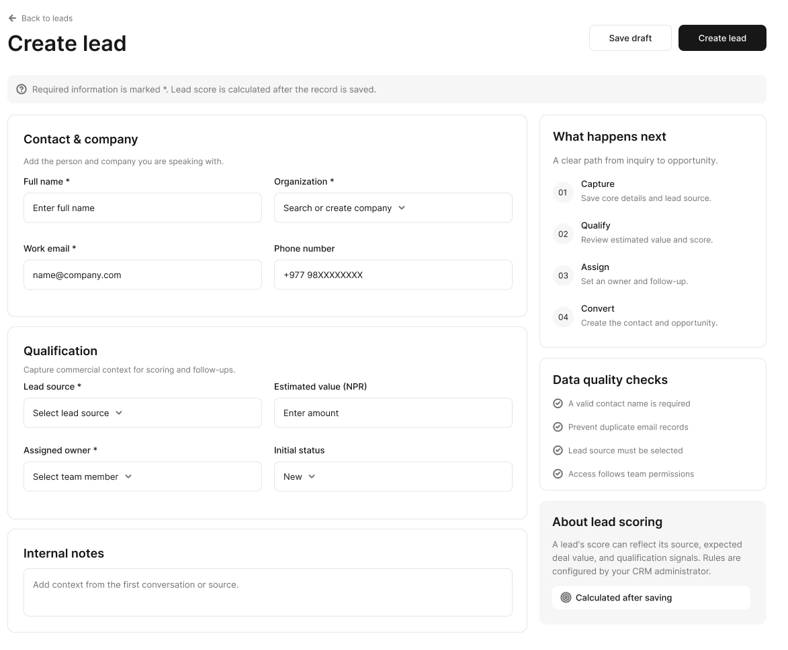
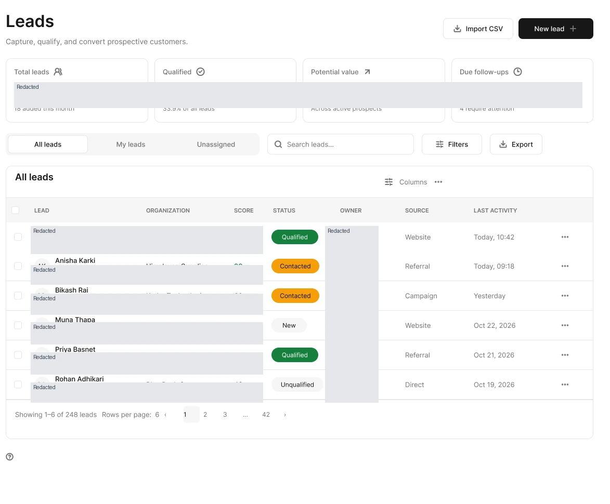
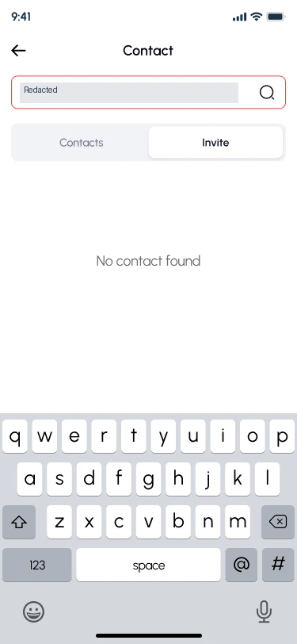
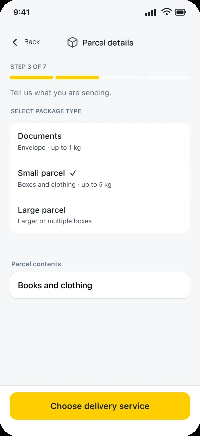
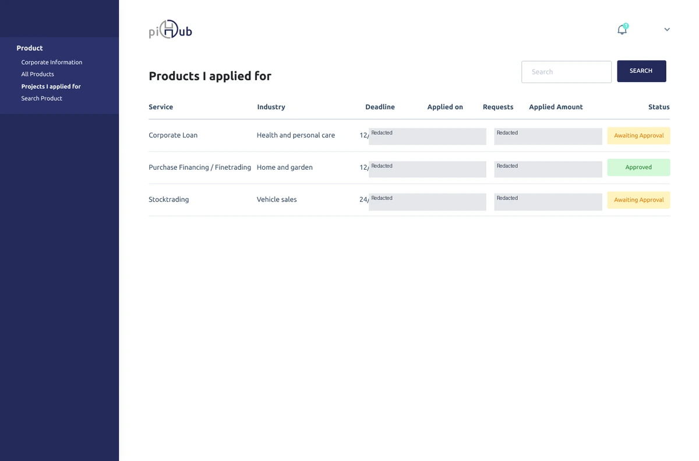
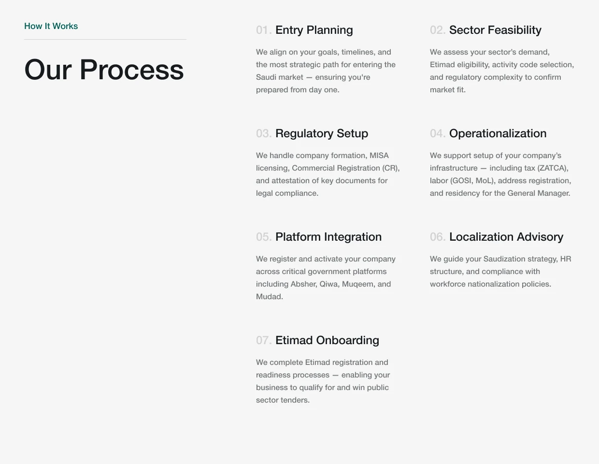
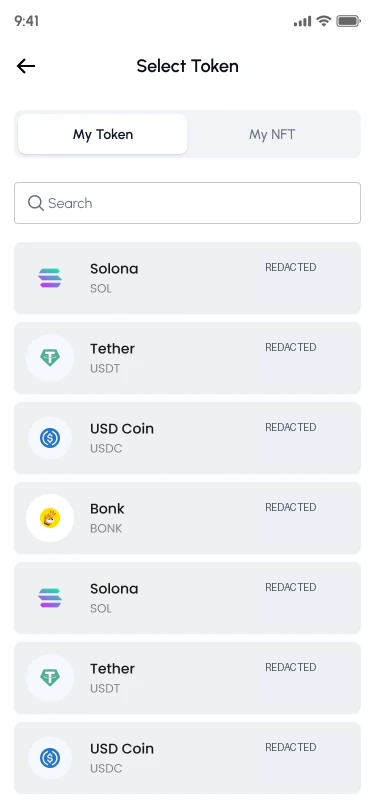

# Article copy review

Review snapshot of the authoritative JSON at code commit `00db48e`. All twenty-six existing article routes are retained; published titles and original publication metadata are preserved where available. Headings here identify the route and distinct editorial intent. This is review-branch content, not a production publication.

## /blog/figma-handoff-notes-for-developers

Intent: Write a behavior contract beside a specific Figma screen

A useful handoff note answers the questions the image cannot: what changes, what persists and what happens when the action does not work.

### Start with the decision, not the measurements

A developer can inspect a frame and still not know what the screen is responsible for. Start the note with the user, the task and the expected result. For example: a CRM operator is creating a lead; a successful save creates a record and returns a stable identifier. That purpose helps resolve implementation choices that a pixel measurement cannot.

Keep the note close to the frame and identify the version it describes. If a newer frame changes the action, update the contract rather than leaving two contradictory explanations on the canvas.

### Use the form to expose unresolved behavior

The Orkest create-lead design groups contact information and qualification and states that the score is calculated after saving. That establishes a visible dependency. It does not establish which values a draft requires, when duplicate checking occurs or what survives a failed request.

Those are the questions I would resolve before calling the form ready for implementation. The screenshot below is source evidence; the accompanying contract is a proposed way to specify behavior, not proof that the product already implements it.

Curated crop of the current Orkest CRM create-lead design. This is design evidence, not a claim about a shipped feature or conversion results.

### Write a state contract someone can test

| State | Specify | Check |
| --- | --- | --- |
| Editing | Required values, defaults and draft rules | Leaving or changing a field does not silently discard work |
| Submitting | Progress feedback and duplicate-submit behavior | A repeated action cannot accidentally create a second intent |
| Validation error | Field message, summary and focus behavior | The person can identify and correct the problem |
| Request failure | Retained values and retry boundary | Recovery preserves valid input |
| Success | Saved identifier and destination | The result is distinct from a merely attempted save |

### Describe responsive and keyboard rules

Explain what changes when space runs out. Which field groups stay together? Does the side panel move after the form, become a disclosure or disappear because the same information exists elsewhere? A screenshot at one width is an example of a rule, not the rule itself.

For a modal step, include focus entry, Tab behavior, dismissal and return focus. W3C's modal-dialog pattern is a useful reference for that interaction. Keep the note focused on the behavior the team actually needs to build.

- [W3C modal-dialog pattern](https://www.w3.org/WAI/ARIA/apg/patterns/dialog-modal/)

### Finish with an owner for every open question

Do not convert an unresolved business rule into a confident annotation. Mark the question, name the decision owner and identify the screen or component it affects. A short list of explicit unknowns is more useful than a complete-looking specification that invents behavior.

Before closing handoff, ask an engineer and reviewer to walk through one success, one invalid input and one interruption using the note. If they need to reconstruct the intended behavior from a meeting, the contract still needs work.

### Related routes

- Figma design-system work: /figma-design-systems
- Inspect the Orkest case: /project-orkest
- Coordinate a startup handoff: /blog/design-handoff-checklist-startup-product-teams

## /blog/blog-good-handoff

Intent: Coordinate responsibility and resolve ambiguity between design and engineering

Handoff is a shared understanding of the product decision. Exporting a polished screen is one part of it, not the point at which responsibility disappears.

### Separate a delivered file from an agreed decision

A file can be complete while the team still disagrees about what a button does. That is why I treat handoff as a review of intent, constraints and unresolved behavior. The useful question is whether another person can continue the work without guessing.

Three kinds of uncertainty tend to get mixed together: a design choice that has not been made, a business rule that belongs to someone else, and a technical constraint that has not been checked. Calling all three a design annotation hides who needs to act.

### Give ambiguity a place and an owner

| Question | Decision needed | Likely participant |
| --- | --- | --- |
| May a draft omit a required field? | Draft and submission rules | Product and engineering |
| What happens after access is revoked? | Authorization and recovery behavior | Engineering and product |
| Which action is primary on mobile? | Task hierarchy | Design with implementation review |
| What counts as accepted? | Observable release conditions | Design, engineering and QA |

### Review a real example instead of a generic checklist

The Orkest create-lead form is a useful review object because it exposes specific dependencies: an owner, an initial state and a score calculated after saving. The handoff conversation should resolve those behaviors, including what remains after failure. It should not stop at whether the fields match the artboard.

Curated crop of the current Orkest CRM create-lead design. This is design evidence, not a claim about a shipped feature or conversion results.

### Keep a small decision record

For each consequential change, record the decision, its reason, the affected frame or component and the implementation status. A sentence can be enough. For example: preserve entered values after a recoverable save failure so retrying does not require rebuilding the form.

Do not bury a changed requirement in a chat thread while leaving the old design marked ready. Update the artifact people will actually use, then identify which existing screens or tests need to change.

### Close the loop in the built product

Review the implementation with realistic content, a keyboard and at least one interrupted task. Compare the behavior with the agreed contract, not only the screenshot. Distinguish a visual difference that preserves intent from a behavioral difference that changes the task.

A handoff is useful when it reduces uncertainty and supports continuation. I would evaluate it by the quality of the questions resolved and the decisions retained through implementation, rather than the number of exported screens or pages of annotations.

### Related routes

- A form with explicit dependencies: /project-orkest
- Write the screen-level contract: /blog/figma-handoff-notes-for-developers
- Design-to-engineering systems: /figma-design-systems

## /blog/design-handoff-checklist-startup-product-teams

Intent: Prepare a bounded design slice for a startup release

A small team needs enough agreement to build safely, without turning every change into a specification project. Use this checklist for a release slice, not the entire product at once.

### Define the slice and its boundary

Name the user, starting point, task and endpoint. Creating a lead is a manageable slice; redesigning CRM is not. List what is deliberately outside the release so an attractive prototype does not quietly become a promise of unsupported behavior.

Attach one primary frame or flow as the current source. Keep older alternatives available if they explain a decision, but label them so engineering does not have to infer which version is approved.

### Check readiness across four responsibilities

| Responsibility | Ready means | Evidence |
| --- | --- | --- |
| Product | Rules and exceptions are decided | A short state or decision table |
| Design | Task, content and states are understandable | Reviewed frames and behavior notes |
| Engineering | Dependencies and failure boundaries are known | Integration assumptions and constraints |
| QA | Acceptance is observable | A short set of task-based checks |

### Run the minimum state review

- Start with realistic data, including a long label and a missing optional value.
- Complete the main task and identify the saved result.
- Trigger a correctable error and confirm that valid input is preserved.
- Interrupt the operation and define what retry means.
- Check an unavailable action or permission boundary.
- Use a keyboard and a narrow viewport to reach the same endpoint.

### Assign open questions before estimating completion

A release checklist should make uncertainty visible. Give each open question an owner and explain which task it blocks. If the integration is unavailable, the team can still review layout and content, but it should not describe that review as end-to-end validation.

Keep conditional acceptance explicit. A flow may be visually ready while its authorization behavior is unverified. Recording both states is more useful than one green label for the entire feature.

### Review the implementation, then preserve the decision

Before release, repeat the agreed checks in the build. Record material differences, their consequence and the decision to repair or accept them. Do not make an acceptance test less demanding simply because the implementation took a different path.

Afterward, update the current artifact and retain a short change record. A startup does not need a large design-operations system to preserve why a consequential choice was made; it needs one reliable place where the next person can find it.

### Related routes

- Screen-level handoff notes: /blog/figma-handoff-notes-for-developers
- Resolve ownership and ambiguity: /blog/blog-good-handoff
- Product design collaboration: /services

## /blog/responsive-saas-dashboard-handoff-notes

Intent: Specify responsive behavior for dense operational interfaces

A responsive dashboard needs rules for priority, overflow and continuation. A desktop frame and a mobile frame leave the hardest decisions between them.

### Write the task that must survive

Start with a concrete task such as locating an unassigned lead and inspecting its status. That gives the responsive design a priority. A small screen may not need every desktop column, but it still needs record identity, current state and a usable route to the next action.

Do not describe responsive behavior as simply hiding secondary information. Name what is secondary for this task, where it remains available and what the person can no longer do in the condensed view.

### Specify behavior by constraint

| Element | Rule to document | Review condition |
| --- | --- | --- |
| Navigation | When and how it condenses | Location and current module remain understandable |
| Table | Column priority and overflow behavior | A record can still be identified |
| Filters | Panel entry, applied state and dismissal | The result context remains visible |
| Actions | Which remain persistent | The primary task is reachable without overlap |
| Detail | Reading order and expandable groups | Labels stay associated with their values |

### Use the desktop evidence honestly

The Orkest leads screen gives a concrete desktop hierarchy: ownership views, search, Filters and qualification states. It is useful for deciding which relationships to protect. It does not show a reviewed mobile filter panel or prove that all responsive states are implemented.

When mobile evidence is incomplete, write the proposed behavior as a requirement and test it in the build. Do not place an unrelated phone screenshot next to the article and call it responsive proof.

Curated CRM screen crop; record identities, organizations and summary values are redacted. Status labels and navigation are retained.

### Document overflow and interruption

Decide whether wide data scrolls inside a labeled region, changes representation or moves into a detail view. If columns are removed, say how the person reaches them. Keep sort and selection behavior explicit when the representation changes.

Also inspect the mobile keyboard, fixed navigation, long translated labels and zoom. A layout that fits in a static screenshot can still hide the save action when the keyboard opens or leave focus behind a fixed control.

### Test the transition, not only the endpoints

Resize with a selected row, an open panel and active filters. Check what persists and where focus goes. Review intermediate widths where neither the ideal desktop nor ideal mobile composition fits comfortably.

A useful acceptance note names an observable result: the record identifier remains visible; the selected action is reachable; the page itself does not overflow; closing a panel returns focus sensibly. Those checks are more durable than one breakpoint number copied from an artboard.

### Related routes

- Orkest record and table design: /project-orkest
- Filter state and persistence: /blog/saas-dashboard-filter-ux
- SaaS product design: /saas-ux-designer

## /blog/saas-dashboard-filter-ux

Intent: Design inspectable filter state for operational record lists

A filter changes the answer a table gives. People need to see the question currently being asked, understand why a record is absent and change that question without losing context.

### Separate a recurring view from a temporary condition

A recurring view answers a familiar question such as which leads belong to me. A filter narrows that view with conditions such as status or date. A saved view may combine both, but the distinction should still be understandable.

The Orkest design separates All leads, My leads and Unassigned from search and Filters. That is visible evidence of the hierarchy, not proof of the open panel's behavior. The design review still needs to decide how conditions combine and persist.

Curated CRM screen crop; record identities, organizations and summary values are redacted. Status labels and navigation are retained.

### Make the current query inspectable

After applying conditions, show enough information to explain the result. A generic Filters badge with a count may be sufficient for a small panel, but a complex query often needs readable conditions. Define whether status is A or B and whether that group is combined with another condition using AND.

Avoid making a person reopen the panel just to explain why a record is missing. A compact summary should be understandable without exposing the entire query builder at all times.

### Decide persistence before building the panel

| Transition | Question to resolve |
| --- | --- |
| Switch ownership view | Are compatible conditions retained, reset or explicitly changed? |
| Open a record and return | Are filters, sort, page and scroll restored? |
| Refresh or share a URL | Which query state is encoded and safe to share? |
| Remove one condition | Does focus remain in a predictable place? |
| Clear all | Does it also clear search and the selected view? |

### Make zero results recoverable

An empty filtered table should retain the conditions that explain it. Use language such as No leads match these filters when that is the known cause, then offer a relevant change. Do not replace the query with a blank onboarding state that suggests no data exists.

Keep a useful result count and check how its update is communicated. For implementations that update without moving focus, W3C's status-message guidance helps distinguish a result announcement from an unnecessary focus change.

- [W3C guidance on status messages](https://www.w3.org/WAI/WCAG22/Understanding/status-messages.html)

### Review with an operational question

Ask someone to find their unassigned work, add a condition, inspect a record and return. Then create a zero-result query and ask them to explain the absence. Observe where the interface forces them to remember hidden state.

The success condition is not that the panel opens. It is that the person understands the active query and can revise it. Keep performance and access restrictions in the review too: a slow result and a restricted result need different explanations.

### Related routes

- The Orkest CRM example: /project-orkest
- Write a zero-result state: /blog/saas-dashboard-empty-state-ux-guide
- Operational SaaS UX: /saas-ux-designer

## /blog/role-based-saas-dashboard-ux

Intent: Separate role tasks, ownership views and authorization

Role-based UX is not a reason to duplicate every screen. Share the meaning of a record and its states, then change the information and actions according to the job.

### Distinguish three different concepts

A role describes a responsibility or access context. Ownership describes a relationship to a record. A view organizes a question someone regularly asks. Mixing those concepts produces interfaces where a label such as My leads appears to promise an authorization boundary that may not exist.

In the Orkest CRM design, All leads, My leads and Unassigned are visible views. They show an ownership model, not evidence that the backend enforces who can read or change a record.

Curated CRM screen crop; record identities, organizations and summary values are redacted. Status labels and navigation are retained.

### Map tasks and actions before designing variants

| Review dimension | Specify separately |
| --- | --- |
| Record visibility | Which records may this person read? |
| Field visibility | Which details may be disclosed? |
| Action | May they create, edit, assign, approve or export? |
| Transition | What state change can that action cause? |
| Recovery | What happens after access changes or an operation is denied? |

### Share the language, vary the priority

piHub's creditor, investor and administrator journeys provide another useful design context. Different people inspect the same broader process for different reasons. A creditor may need outstanding requirements, while an administrator needs review context. Reusing the state vocabulary can help the product remain coherent without making both screens identical.

Those prototypes are separate design artifacts. They do not establish synchronized updates or real permission enforcement. A source-linked case study should keep that distinction visible rather than presenting visual role coverage as security verification.

### Design denial without leaking information

An unavailable action needs an explanation appropriate to the situation. Hiding an action may simplify a routine view; showing a disabled action can explain a dependency. Neither choice by itself establishes security. The server must decide whether the request is allowed.

Be careful about revealing the existence of restricted records. Work with the product and engineering owners to decide what can safely be said, then make the recovery path useful within that boundary.

### Test the boundary outside the happy path

- Open a direct record URL with a different role.
- Attempt the same action after ownership or access changes.
- Check export, search and bulk actions as well as individual buttons.
- Return to a stale tab after a session or permission change.
- Confirm that the interface explains the result without claiming a save that did not occur.

### Judge the model by a shared scenario

Trace one example record across the relevant roles and write down what each person sees and may do. This makes inconsistencies easier to discuss than a gallery of disconnected dashboards. It also separates a design proposal from the engineering evidence required to call the permission model verified.

### Related routes

- Multi-role fintech design: /project-pihub
- CRM ownership views: /project-orkest
- Enterprise workflow design: /saas-ux-designer

## /blog/saas-dashboard-empty-state-ux-guide

Intent: Write concise explanation and recovery copy for one zero-result state

Before writing an empty-state headline, identify what the interface actually knows. The next action should follow the cause, not a reusable illustration.

### Write the cause before the call to action

No data is a description of the display, not an explanation. A new workspace, an over-restrictive filter and a failed request may all leave an empty panel, but they require different messages. Start by writing one sentence about why this result is empty, using only information the application can establish.

Then choose an action that changes that cause. Create your first lead fits an eligible new workspace. Clear filters fits a filtered result. Retry fits some request failures. Using one button for all three can send the person in the wrong direction.

### Use a small cause-to-copy worksheet

| Known cause | Possible explanation | Relevant action |
| --- | --- | --- |
| No matching records | No leads match these filters | Change or clear conditions |
| No records created | This workspace has no leads yet | Create or import, if permitted |
| Request failed | We could not load the leads | Retry with retained context |
| Access is insufficient | Use an approved access explanation | Request access when supported |
| Setup is incomplete | Name the missing setup step | Continue setup |

### Inspect a real zero-result frame

The Yarsha contact-search design reports No contact found while retaining the search context and keyboard. It is a mobile example of the same writing problem, not a SaaS dashboard screenshot. Contacts and Invite are visible, but the frame does not explain whether invitation is the right recovery for this query.

A useful revision discussion would ask whether the person can broaden the search, clear it or understand the Invite route. The image supports those questions; it does not establish that they have already been answered.

Final Mobile Design page: a contact-search empty state. The entered name is redacted. This screen supports a discussion of recovery options; it does not demonstrate a wallet transaction.

### Keep the message proportionate

A routine search with no matches rarely needs a large celebratory illustration or a paragraph about the product's value. Name the result, keep the query visible and provide a concise continuation. A first-use state may need more explanation because the person has not yet learned the model.

Avoid blame. Invalid input can be described precisely without suggesting carelessness. When the cause is unknown, use an honest loading or error explanation instead of confidently stating that the account contains no records.

### Review the words in a transition

Enter a zero-result query, change it and return after data becomes available. Check that the explanation updates with the state and that the recovery action does not discard useful input. Review how the result is announced without forcing unnecessary focus movement.

This guide focuses on the copy and action for one observed state. For product-wide consistency, classify the causes first; for implementation acceptance, test persistence and recovery separately.

### Related routes

- Build a product-wide empty-state taxonomy: /blog/saas-dashboard-empty-states-product-clarity
- Test recovery and persistence: /blog/saas-dashboard-empty-states-that-help-users-recover
- SaaS design work: /saas-ux-designer

## /blog/saas-dashboard-empty-states-product-clarity

Intent: Classify empty-state causes across a product

A product needs an empty-state model before it needs an empty-state component. Visually similar panels can represent different responsibilities and different risks.

### Use two axes: cause and agency

First identify why the surface is empty. Then identify who can change that situation: the current user, another person, a background process or nobody within the product. The combination gives the design a more useful starting point than a generic list of empty-screen layouts.

A first-use state with an enabled creation action is different from the same first-use state shown to a read-only role. The visible absence may be identical, but the available continuation is not.

### Create a small taxonomy

| Cause | What needs explanation | Agency |
| --- | --- | --- |
| First use | What belongs here and how it arrives | Creator or administrator |
| Filtered result | Which conditions produced no matches | Current user |
| Incomplete setup | What prerequisite is missing | Setup owner |
| Permission | What may safely be disclosed | Access owner |
| Synchronization | Whether the result is still pending | System or integration |
| Failure | What is known and what remains intact | User, support or system |

### Make classification part of the component API

A reusable component needs enough inputs to express a meaningful state: title, explanation, optional context and an appropriate action. It should not force every cause into the same primary button or celebratory visual.

Keep authorization and data fetching outside the presentational component. A UI variant can represent a permission state, but it cannot decide whether a person is entitled to see a record. That decision belongs to the product's actual access model.

### Review adjacent states together

Place loading, loaded, empty, stale and failed states beside each other during design review. Ask whether they can be distinguished without relying on color. A delayed synchronization should not briefly look like an authoritative statement that no data exists.

Also review how the state changes after a successful action. If a new record arrives, the empty message should give way to the relevant content. If another person must act first, the interface should preserve the explanation rather than offering a misleading retry loop.

### Keep an inventory with named owners

For each module, record the cause, role, source of truth, recovery action and open question. This exposes places where a visually shared pattern masks different business rules. It also helps the team identify which parts of the model can be reused and which need an exception.

This is a product-wide classification exercise, not the short copywriting task covered by the focused empty-state guide. A consistent taxonomy makes the component useful because the team understands what each variant means.

### Related routes

- Write the individual message: /blog/saas-dashboard-empty-state-ux-guide
- Verify the recovery path: /blog/saas-dashboard-empty-states-that-help-users-recover
- Reusable component systems: /figma-design-systems

## /blog/saas-dashboard-empty-states-that-help-users-recover

Intent: Acceptance-test empty-state recovery and retained context

An empty state is useful when someone can continue from it. Test the transition, retained input and result of the recovery action, not only the appearance of the panel.

### Name what must remain intact

Before designing a recovery action, list the context the person may still need: search terms, active filters, selected workspace, sort order, page position and unsaved input. A recovery that silently resets all of it can create more work than the original empty result.

Separate recoverable context from stale or unsafe context. A selection from a previous permission scope may need to be cleared. The important point is to decide and explain the rule rather than letting it emerge accidentally from a rerender.

### Test a transition matrix

| Scenario | Recovery action | Acceptance question |
| --- | --- | --- |
| No search matches | Edit or clear the query | Does the query remain available to revise? |
| Conflicting filters | Remove one condition | Can the person see which condition changed? |
| Loading failed | Retry | Is valid context retained and the request outcome explained? |
| Setup completed | Return to the module | Does the new state reflect the completed prerequisite? |
| Access changed | Reload or request access | Is restricted context handled consistently? |
| New data arrives | Refresh or observe an update | Does empty become loaded without a misleading intermediate result? |

### Keep focus and announcements useful

A changed result does not always need a focus jump. Keep the person near the control they are using unless the next task genuinely requires moving them. If a brief status changes without receiving focus, make that information available to assistive technology in an appropriate way.

W3C's status-message guidance distinguishes those updates from a change of context. Use it to review the behavior, then test the actual implementation rather than assuming an accessibility attribute is sufficient.

- [W3C status-message guidance](https://www.w3.org/WAI/WCAG22/Understanding/status-messages.html)

### Prevent recovery from becoming a repeated mistake

A retry button needs a meaningful retry boundary. If the underlying prerequisite is still absent, repeating the same request may accomplish nothing. Explain the dependency or offer the action that can change it.

For record creation or other consequential operations, determine whether the first attempt may already have succeeded before offering another submission. The interface should not imply certainty when the request outcome is unknown.

### Record the result at task level

Write a short observation: the query was retained, the person removed one filter, the result returned and focus remained on the relevant control. That is stronger evidence than marking the empty-state component complete because its spacing matches the design.

This article covers recovery verification. Use the taxonomy article to classify causes and the concise guide to write the message that introduces the recovery.

### Related routes

- Classify the cause: /blog/saas-dashboard-empty-states-product-clarity
- Write a useful explanation: /blog/saas-dashboard-empty-state-ux-guide
- Review states and recovery: /ux-audit

## /blog/ux-audit-evidence-before-redesign

Intent: Build an evidence pack before deciding what to redesign

A useful audit connects an observed problem to a task and a decision. Screenshots, analytics and opinions contribute different kinds of evidence; they should not be treated as interchangeable.

### Begin with a question the evidence can answer

Why is onboarding difficult is too broad to investigate in one pass. Can a new administrator identify the next required setup action is a more workable question. It names a role, task and point in the journey.

Record what you already know and what remains a hypothesis. A support complaint may identify a symptom. An event funnel may locate a drop. Neither automatically explains the cause. Use the initial question to decide which evidence to collect next.

### Collect complementary evidence

| Source | What it can establish | What it cannot establish alone |
| --- | --- | --- |
| Observed task | What happened in that session | How common it is across all users |
| Product analytics | Recorded event patterns | Why the person acted that way |
| Support material | Reported friction and vocabulary | The experience of people who never contacted support |
| Interface inspection | Visible structure and behavior | A measured business consequence |
| Technical logs | Recorded failures and timing | The person's understanding of the failure |

### Attach provenance to each finding

Capture the build or environment, role, viewport, starting state, steps and result. Add a screenshot or recording only when it helps another person inspect the observation. Remove personal and client data from the version that will be shared.

Keep the original observation separate from the interpretation. For example: the save failed and the form cleared is an observation; people will abandon because of this is a hypothesis unless further evidence supports it.

### Use a reproducible finding format

- Task: what the person was trying to do.
- Observation: what actually happened and where.
- Consequence: what was blocked, lost or made ambiguous.
- Evidence: source, date and reproduction steps.
- Confidence: confirmed, observed once or needs reproduction.
- Next decision: repair, investigate, accept or redesign.

### End with a decision-ready pack

Group findings by the decision they inform. Several navigation symptoms may share one naming problem; a failed integration may need an engineering repair rather than new screens. The point is to narrow the redesign question, not make the issue count impressive.

For portfolio work, be equally careful about evidence. A Figma screenshot can demonstrate a proposed hierarchy. It cannot stand in for an observed usability session or a shipped outcome. Keeping those categories separate makes both the audit and the case study more credible.

### Related routes

- Evidence-led UX audits: /ux-audit
- Prioritize the findings: /blog/prioritize-ux-audit-findings-before-redesign
- A workflow with review dependencies: /project-pihub

## /blog/ux-audit-checklist-before-redesign

Intent: Run a reproducible task-based interface audit

Use this checklist to inspect one important journey from entry to recovery. A page-by-page visual review can miss the behavior that makes the task succeed or fail.

### Set up a real starting condition

Choose a role, a task and a realistic account state. Note the environment, viewport and any unavailable integration. If the test uses seeded data or a prototype, say so. A successful prototype click does not prove that saving, permissions or synchronization work.

Start from a route a person could actually use, including a deep link where appropriate. A flow that works only after a guided tour from the homepage has an entry problem worth recording.

### Walk the task, then the exception

| Area | Inspection question | Evidence to capture |
| --- | --- | --- |
| Orientation | Can the person identify location and purpose? | Labels, current state and entry path |
| Action | Is the consequence understandable before commitment? | Action text and review context |
| Input | Are requirements and correction paths clear? | Validation and retained values |
| Waiting | Does the interface explain what it is waiting for? | Progress or pending state |
| Failure | Can the person continue without losing useful work? | Error and recovery sequence |
| Completion | Is the result distinguishable from an attempt? | Saved record, confirmation or next state |

### Inspect access and alternate input

Repeat the core path with a keyboard and a narrow viewport. Check meaningful names, visible focus, logical order and whether fixed controls cover the current task. Review zoom and the mobile keyboard rather than treating a small screenshot as responsive verification.

For role-based software, try a direct route and an unavailable action with the correct test account. Record what the server and interface actually do; a hidden button is not evidence of authorization enforcement.

### Use one concrete design example

The Zapp parcel-details frame asks for package type and contents before choosing a delivery service. It gives an audit a specific sequence to inspect: can the customer understand the options, revise an answer and continue after a validation problem? The image establishes the proposed layout; the task test must establish behavior.

Customer iOS parcel-details frame from the supplied primary Zapp 2.0 file. This is a design state, not evidence of working pricing, dispatch or delivery.

### Turn the result into a bounded decision

Record the failure at the task level and separate confirmed behavior from a suspected cause. Preserve the conditions needed to reproduce it. Then decide whether the repair belongs in copy, layout, interaction, business rules or engineering.

The checklist is complete when it produces decisions someone can act on. It is not a certification that every state, role or assistive technology has been covered. State the tested scope and the remaining gaps explicitly.

### Related routes

- Zapp customer journey evidence: /project-zapp
- Product UX review: /ux-audit
- Build the evidence pack: /blog/ux-audit-evidence-before-redesign

## /blog/prioritize-ux-audit-findings-before-redesign

Intent: Choose a defensible repair order without false numerical precision

A long issue list becomes useful when the team can explain why one problem deserves attention before another. Separate user consequence, evidence confidence and delivery effort.

### Start with consequence, not the screenshot

A visually obvious issue can be less consequential than a rare failure that loses work or prevents access. Describe what happens to the task: blocked, completed incorrectly, recoverable with extra work or merely less comfortable.

Keep severity separate from frequency. A single observed destructive failure may deserve immediate investigation even when its prevalence is unknown. Conversely, a frequently seen cosmetic difference does not automatically justify structural redesign.

### Keep confidence visible

| Evidence state | Reasonable action |
| --- | --- |
| Reproduced failure | Repair or explicitly accept the known consequence |
| Observed once with clear conditions | Reproduce and investigate while preserving evidence |
| Consistent reported theme | Inspect the affected task and corroborate the cause |
| Expert concern | Frame as a hypothesis or targeted review |
| Preference | Treat as a design choice unless a consequence is established |

### Use an order the team can defend

My preferred starting order is access and data integrity, blocked core tasks, repeated recovery costs, confusing decisions and then polish. The exact order depends on the product, but naming the reason makes it possible to challenge the decision constructively.

Do not multiply guessed values into a precise-looking score. If occurrence is unknown, write unknown. If delivery effort has not been assessed by engineering, keep it provisional. The discussion should reveal uncertainty rather than hide it inside arithmetic.

### Separate quick repair from structural work

An incorrect label may be a small repair with a meaningful benefit. Several inconsistent states may indicate a shared component or data-model problem. Group related symptoms before estimating fixes so the team does not repeatedly patch the same cause.

Also record dependencies. A design repair can be ready while an API contract is unresolved. That does not make the whole item complete, and it should not prevent unrelated verified repairs from moving forward.

### Keep a decision ledger

- Finding and affected task.
- Observed consequence and evidence link.
- Severity and confidence, recorded separately.
- Proposed repair and accountable owner.
- Dependency or decision that blocks progress.
- Verification that will demonstrate the repair.
- Reason for accepting or deferring the issue.

### Revisit priority after learning

Priority is a current decision, not a permanent property of a ticket. A reproduced failure, a changed release scope or new evidence can change the order. Keep the original observation and record why the decision changed.

A good audit creates a smaller set of consequential decisions and a reliable verification path. Closing a large number of low-value tickets is not a substitute for resolving the task failures that matter.

### Related routes

- UX audit and remediation: /ux-audit
- Collect better evidence: /blog/ux-audit-evidence-before-redesign
- Decide whether an audit is the next step: /blog/when-startup-needs-ux-audit-before-redesign

## /blog/when-startup-needs-ux-audit-before-redesign

Intent: Decide whether to audit, repair or redesign a startup product

A redesign is a commitment to change. An audit is useful when the team first needs to understand which change is warranted and which existing behavior should be preserved.

### Identify the decision you cannot yet make

The interface looks old is not enough to choose a redesign scope. The useful uncertainty might be why onboarding stalls, whether navigation matches user tasks or whether a feature is hidden behind an access problem. Name that uncertainty before commissioning a broad visual refresh.

An audit is a good next step when the team has symptoms but cannot connect them to a defensible repair. If the defect is already known and reproducible, fixing it may be more useful than paying for another report.

### Choose a response that matches the evidence

| Situation | Useful next move |
| --- | --- |
| A known broken save | Repair and regression-test the failure |
| Conflicting explanations for abandonment | Collect evidence around the affected task |
| A new role or business model | Review the task and information architecture |
| Inconsistent UI with stable behavior | Assess component and content-system repair |
| A new visual direction only | Bound the visual work and protect existing behavior |

### Scope the audit around a consequential journey

For a small team, start with one important role and one end-to-end task. Include entry, input, waiting, failure and completion. Identify the integrations and account states needed to test it.

The Zapp parcel step is an example of a bounded review object. It can be inspected as part of a booking journey without pretending that a single screen explains dispatch, payment and delivery operations. A sensible scope makes those boundaries explicit.

### Ask for a decision-ready deliverable

The output should contain reproducible findings, consequences, confidence, a proposed repair order and a verification plan. It should distinguish copy fixes, interaction changes, structural redesign and engineering defects.

Avoid a scope that promises a predetermined redesign regardless of what the evidence shows. An audit should be able to conclude that a smaller repair is enough, that more evidence is needed or that a part of the existing product deserves protection.

### Do not delay urgent repairs for the perfect study

A clear access failure, data loss or broken critical path deserves attention while broader investigation continues. Record the original condition and test the repair. There is no need to wait for every secondary finding before addressing a verified problem.

For less certain concerns, make the next experiment small and reversible. The goal is a better product decision with a known basis, not a larger design programme justified by the existence of an audit.

### Related routes

- Scope an evidence-led review: /ux-audit
- Run the journey checklist: /blog/ux-audit-checklist-before-redesign
- Choose a repair order: /blog/prioritize-ux-audit-findings-before-redesign

## /blog/beautiful-interface-poor-ux

Intent: Diagnose task problems concealed by visual polish

A polished screen can still leave the person unsure what to do, what changed or whether their work is safe. Review the decision the interface supports before judging the composition.

### Ask what the person can explain

A screenshot can look balanced while every action competes equally. Try a more specific review: what needs attention, what is the next action and what consequence will it have? If those answers are unclear, visual hierarchy is not yet supporting decision hierarchy.

This does not make visual craft unimportant. Typography, spacing and contrast are valuable because they help a person read relationships and priorities. The problem is treating their presence as evidence that the task works.

### Look for the state the presentation omits

The default screen rarely shows what happens after a failed save, an unavailable permission or an empty result. Those states often carry the explanation a person most needs. Review them with the same care as the ideal composition.

The Yarsha contact-search frame is a useful example. It clearly reports No contact found, but the continuation still deserves inspection. Does the person know whether to change the query or use Invite? A clean layout can expose a good design question without proving it has been solved.

Final Mobile Design page: a contact-search empty state. The entered name is redacted. This screen supports a discussion of recovery options; it does not demonstrate a wallet transaction.

### Use four small diagnostic tasks

- Explain the main action before selecting it.
- Find the state and next action without relying on a color cue.
- Trigger one error and recover without re-entering valid work.
- Reach the same result using a keyboard and a narrow viewport.

### Distinguish motion from feedback

A movement or color change can signal activity without explaining the result. For a consequential action, feedback should establish whether the operation is still pending, completed, rejected or unresolved. Animation can support that explanation; it should not replace it.

Also review reduced-motion behavior. If the only way to understand a result is to follow an animated sequence, the product needs an equivalent explanation that remains usable without that sequence.

### Repair the model before adding emphasis

A larger primary button will not resolve an action whose meaning is unclear. First decide the task, state and consequence. Then use the visual system to make that decision easier to read.

For portfolio review, I prefer to connect a specific screen to the decision it supports and the questions still open. An attractive interface is evidence of craft. A task-based review supplies the additional evidence needed to judge the experience.

### Related routes

- Inspect the source example: /project-yarsha
- Review task behavior: /ux-audit
- Write a useful zero-result explanation: /blog/saas-dashboard-empty-state-ux-guide

## /blog/saas-dashboard-ux-checklist

Intent: Review the core task hierarchy of an operational dashboard

A dashboard should help someone notice what matters and act on it. Use this checklist to review one role's work, not to collect every chart and table pattern in one screen.

### Start with the decision the dashboard supports

Write a task such as identify leads that need assignment or inspect applications waiting for review. Then identify the information required to make that decision. This gives the layout a reason to emphasize one state, action or comparison before another.

A summary metric earns its place when it changes what the person should inspect or do. If it is only decorative reassurance, it may belong elsewhere or need a clearer relationship to the task.

### Review the dashboard in six passes

| Pass | Question |
| --- | --- |
| Location | Which workspace, module and scope am I viewing? |
| Priority | What requires attention before routine work? |
| Records | Can I identify the object and compare relevant values? |
| Query | Which search, filters and sort explain this result? |
| Action | What can I do, and what changes if I do it? |
| Recovery | What happens if data, permission or the request is unavailable? |

### Inspect one source-backed example

The piHub creditor design puts application details and explicit status in the same comparison view. Its value as evidence is the relationship between the record and state. Redacted sample amounts are not product performance, and the image does not verify the approval workflow.

Creditor application-list design. Dates, request counts and amounts are redacted; these rows are not reported business results.

### Check density against the job

Dense views can support comparison when labels, units and identifiers are stable. A review or creation step may need a quieter hierarchy because the consequence deserves attention. Do not use whitespace as the sole measure of clarity.

At narrow widths, decide which relationships survive. A person should still be able to identify a record and reach its relevant action even if secondary columns move to a detail view. Test with realistic names and missing optional values.

### Exercise the state, not just the layout

- Load the view with no records and with no matching records.
- Apply a filter, inspect a record and return.
- Change the selected workspace or role.
- Interrupt a request and inspect retained context.
- Use a keyboard to reach search, filters and a row action.
- Check whether a stale or partial result is distinguishable from a genuine zero.

### Record a task-level conclusion

Summarize what the dashboard enables and which decision remains difficult. A useful conclusion might be that record status is clear but ownership is hidden, or that the next action disappears on mobile. That is more actionable than saying the dashboard needs a modern look.

Keep the tested role, data and viewport in the report. A checklist pass on one template is not evidence that every module or authorization boundary has been verified.

### Related routes

- Application-status design: /project-pihub
- Review filter behavior: /blog/saas-dashboard-filter-ux
- SaaS dashboard design: /saas-ux-designer

## /blog/website-ux-checklist-software-companies

Intent: Review a software website as an evaluation journey

A software website should help a serious visitor understand the offer, inspect relevant proof and choose a sensible next step. Review that journey before adding another visual effect.

### Test the opening explanation

After a short scan, can a visitor explain who the product is for and what it helps them do? A category label may be necessary, but it should not carry the entire explanation. Replace a broad claim with a concrete task or outcome the product can actually support.

For a technical product, keep a route to deeper detail. The first explanation and the implementation explanation have different jobs. A newcomer should not need to read documentation to establish relevance, and an evaluator should not be trapped in marketing summaries.

### Review the evaluation path

| Visitor question | Useful page evidence |
| --- | --- |
| Does this fit my problem? | Specific audience, use case and scope |
| What does it do? | Capabilities explained through tasks |
| Why should I believe it? | Relevant examples and inspectable references |
| What are the limits? | Clear exclusions and dependencies |
| How do I continue? | An appropriate demo, documentation or contact action |

### Keep proof next to the claim

A screenshot is useful when it helps inspect a capability or a design decision. A logo or decorative interface image does not establish a customer result. Narrow the claim when the available evidence is narrow.

The Mokshya case concerns website communication and technical reading depth. The Splashnode case concerns a technical platform website and frontend contribution. Neither should be inflated into ownership of the underlying protocol or platform just to make a stronger sales story.

### Inspect navigation and contact in context

Use descriptive links and check whether the visitor can find a relevant capability from several reasonable entry points. A service page may be a better landing page than the homepage for a specific search or referral.

Review the contact step with the explanation that precedes it. Does the person know what the conversation is for and what information to provide? Avoid asking for sensitive or excessive details before they are needed.

### Review the actual page, not only the design

- Read meaningful content with scripts unavailable where feasible.
- Check headings, descriptive links and image alternatives.
- Use the navigation and contact path with a keyboard.
- Review long headings, zoom and narrow screens.
- Measure image, font and script loading with real page data.
- Verify metadata, canonical URLs and the intended destination of old links.

### Use findings to refine the offer

If visitors cannot identify the right service, the repair may be information architecture rather than a new hero. If the page makes unsupported claims, the repair is evidence or narrower wording. Technical SEO and performance support discovery and access; they cannot make an unclear offer useful on their own.

### Related routes

- Website UX services: /website-ux-design
- Technical product communication: /project-mokshya
- Service-page content structure: /blog/blog-service-websites

## /blog/blog-design-systems-front-end

Intent: Connect design-system decisions to frontend responsibilities

A design system becomes useful when its concepts survive implementation. I look for clear responsibilities between tokens, components, content and product behavior.

### Share meaning before sharing names

A color named blue-500 is a value. A token named action-primary describes a responsibility. Both can be useful, but they solve different problems. A frontend-aware system needs an explicit relationship between visual values and the roles they serve.

The same principle applies to spacing and typography. A token list is not automatically a component contract. The team still needs to decide which values may change together and where a product-specific exception belongs.

### Define the component beyond its default frame

Take an input. Its contract includes label, help, value, error, disabled behavior and content constraints, not only its height and border. The surrounding form owns some decisions, such as validation timing and submission state. Keeping those responsibilities distinct prevents a reusable input from accumulating unrelated product logic.

In the Orkest create-lead design, the visible form provides a concrete place to discuss that boundary. A reusable control can display an error, but the business rule that decides whether a lead is valid is not proved by the control's appearance.

Curated crop of the current Orkest CRM create-lead design. This is design evidence, not a claim about a shipped feature or conversion results.

### Treat content variation as part of the API

- Which labels are required and which may be omitted?
- What happens with long text, an unknown value or an unavailable image?
- Does the component reserve space for changing content?
- Which state changes should be announced?
- Who owns focus when the component opens or closes another surface?

### Review the boundary in both tools

A Figma variant and a coded prop do not need identical syntax, but they should represent compatible decisions. Compare a few real usages and inspect where the models diverge. Is a design variant encoding a one-off layout? Is a coded option hiding a shared behavior that deserves documentation?

For my SassBoilerplate work, the same concern appears at a smaller scale: file responsibilities should make change easier to locate. A larger toolchain does not automatically produce a clearer system.

### Govern exceptions instead of denying them

Some product tasks need a different pattern. Record the reason, the scope and the owner. If the same exception keeps appearing, it may belong in the shared system; if it is local, avoid forcing every product to carry it.

I judge system quality by whether a team can make and review the next change coherently. Component counts and token coverage are useful inventory measures, but they do not prove that the system is understandable or maintainable.

### Related routes

- Design-system consulting: /figma-design-systems
- A smaller developer-experience example: /project-sassboilerplate
- Keep a small system proportional: /blog/design-systems-small-product-teams

## /blog/design-systems-small-product-teams

Intent: Build a proportional design system for a small team

A small team needs a reliable way to repeat and change decisions. It does not need to reproduce the operating model of a much larger organization.

### Start where repetition already costs something

Audit a few current screens and identify repeated decisions: field labels, validation, spacing, action hierarchy or table states. Choose a pattern that is used often enough to justify a shared contract. A hypothetical future component is a weaker starting point than a repeated inconsistency the team already maintains.

Keep the first scope small. A handful of semantic tokens and a well-specified form pattern can be more useful than a library with hundreds of incomplete variants.

### Give each shared pattern a small contract

| Part | Minimum useful explanation |
| --- | --- |
| Purpose | When to use it and what it is responsible for |
| Inputs | Required content and optional variation |
| States | Behavior under loading, error and unavailability |
| Constraints | Responsive and content limits |
| Ownership | Who reviews a change and where it is recorded |

### Use real examples to limit variants

Before adding another variant, find the use case that requires it. If the difference is only temporary content, it may not need a new component shape. If it changes behavior or information priority, it deserves a more explicit review.

Keep product decisions outside the shared component when they are not genuinely reusable. A primary button should not know whether a specific financial application is eligible for approval. The product owns that rule.

### Document the escape hatch

An exception process can be a short note: what changed, why the shared pattern was insufficient and whether the result should be reused. This gives the team room to solve a real task without silently fragmenting the interface.

Review repeated exceptions periodically. They may reveal a missing capability, an unclear contract or a pattern that no longer fits. Deleting a weak abstraction can be a system improvement.

### Measure continuation rather than library size

Ask another teammate to use and modify a pattern without a verbal tour. Inspect what they misunderstand and which questions the documentation fails to answer. Check a built usage with long content and an error state.

For a small team, the useful result is a shorter path from a product decision to a coherent implementation. Treat that as something to observe, not an efficiency percentage to invent because a component library exists.

### Related routes

- Proportional design-system work: /figma-design-systems
- Connect design and code contracts: /blog/blog-design-systems-front-end
- Contribution inside an established product: /project-masteriyo

## /blog/blog-service-websites

Intent: Write a service website around client evaluation

A service page needs to help someone recognize their situation, understand the scope and decide whether a conversation is worthwhile. A list of capabilities is only the starting material.

### Begin with the client's question

A client may arrive with a problem rather than the name of a discipline. Organize the opening around that recognizable situation, then explain what the service includes. Avoid making the visitor translate internal terminology before they can establish fit.

A useful opening also has boundaries. Say what kind of work the service covers and what it does not. Broad claims about solving every business problem make evaluation harder, even when they sound confident.

### Use scope and sequence as evidence

The Morajaa market-entry design includes a named process after its service explanation. The reviewed crop shows how stage titles create a scan while supporting text supplies depth. It is evidence of content hierarchy; it does not independently verify the consultancy's regulatory statements or delivery results.

Curated process-section crop from the supplied Final Design v2 service screen. Photography and staff details are outside this crop. Source service statements are not independently verified legal or commercial claims.

### Give the page a useful sequence

| Section | Question it should answer |
| --- | --- |
| Situation | Is this relevant to my problem? |
| Scope | What work is actually included? |
| Approach | What would working together involve? |
| Proof | What can I inspect to evaluate the claim? |
| Boundary | What should I not assume? |
| Next step | What will happen if I make contact? |

### Keep proof specific and permission-aware

Use a project example because it helps evaluate the service, not because the page has an empty image slot. Explain the contribution and distinguish a design artifact from a commercial result. A screenshot can show a decision without proving a client outcome.

If the strongest material is private, narrow the public account rather than replacing it with an invented result. A clear contribution statement is more useful than a confident but unsupported success story.

### Carry context into the inquiry

A contact action should follow enough explanation for the person to know what they are asking about. Keep the form proportional to that first conversation. If it preserves a selected service, make that context visible and editable.

Review the mobile reading order and the route back to supporting information. The website should let a careful visitor evaluate the offer without forcing immediate contact or burying the action after repetitive content.

### Related routes

- Morajaa service architecture: /project-morajaa
- A studio website contribution: /project-hamro-idea
- Website UX design: /website-ux-design

## /blog/blog-portfolio-product

Intent: Explain portfolio editorial and interaction decisions using the current site

I want a portfolio to help someone evaluate my judgment, not only recognize a visual style. That means treating evidence, navigation and performance as part of the same product.

### Give the visitor a question to answer

A recruiter may be asking whether I can handle a particular kind of complexity. A potential client may be checking whether my contribution matches their problem. Those are evaluation tasks. The portfolio should help people find relevant work and understand what it actually demonstrates.

That is why a case study needs a precise scope and an inspectable artifact. A broad statement about strategy is weaker than a concrete decision connected to a form, a record model or a responsive content problem.

### Keep the visual identity, reduce the evaluation cost

This site uses an editor-inspired workspace with expressive type and motion. I want that personality to remain, while the project and article pages use the same navigation, fonts and interaction language. A strong homepage followed by unrelated inner-page styling makes the experience harder to trust and maintain.

Shared presentation does not mean shared prose. A logistics journey, a consulting website and a Sass utility need different explanations and different kinds of proof.

### Make the evidence boundary visible

In the current editorial revision, Figma exports are separated from public derivatives. Screens are selected for the decision they help explain, identifying values are redacted where necessary and the source is recorded. Drafts and legacy prototypes are not silently presented as current releases.

Where a matching file is missing, the case keeps the gap visible. Code or an existing website artifact may be better evidence than a design screenshot. No visual placeholder can establish a result that was never measured.

### Treat performance as part of access

An elaborate interface still needs to be readable and usable on a narrow screen and a slower connection. I use repeatable builds, route checks and browser audits to inspect the implementation. A laboratory score is a measurement of a tested configuration, not a guarantee of everyone's experience.

The current review also separates code readiness from production deployment and Google indexing. Those are different states. A successful local test cannot establish that a search engine has processed a change.

### Choose an honest next improvement

The portfolio is still a product with constraints. A screenshot archive can be incomplete, a client example can require permission and a manual accessibility review can remain outstanding. Recording those limits gives the next improvement a clear starting point.

My practical test is whether someone can find a relevant case, explain my contribution, inspect the evidence and decide whether to contact me. The visual identity should support that evaluation rather than become a separate task to solve.

### Related routes

- Explore the case studies: /projects
- Read my background: /about
- Discuss a product: /contact

## /blog/blog-gaming-interface-clarity

Intent: Apply gaming-interface observations to data-product design without invented research

Playing complex games and working on a combat-data tool keeps bringing me back to the same interface question: can I tell what matters now, and can I inspect why?

### Separate immediate action from later analysis

An active encounter and an after-action review have different information needs. During action, a person needs a small number of timely cues. Afterward, they may want a dense view of events, comparisons and explanations. Trying to give both moments identical density can make each less useful.

I use that distinction as a design lens rather than a universal rule about players. It also applies to operational software: the person resolving an urgent task may need a focused action view while the analyst needs a broader comparison.

### Make state legible without remembering every detail

A useful interface keeps the context that changes meaning close to the value. In a combat-data tool, encounter, actor, time range and filters affect interpretation. In a business dashboard, workspace, role and record state do similar work.

My Neverwinter Live Parser case is about that information-design problem. It is not a claim that the tool makes someone perform better in the game or that every calculation has been independently validated.

### Use progressive detail to answer a question

A summary should help someone identify a question worth investigating. A drill-down should then answer it with the appropriate context. Showing more data is not automatically a better diagnostic experience.

For example, a changed total should be inspectable through its selected range and supporting events. If the capture is partial or ambiguous, the interface should keep that limit visible rather than presenting a precise number as complete truth.

### Review four conditions

- The person needs to act immediately and cannot inspect every detail.
- The person returns later and needs to reconstruct the context.
- A filter changes the meaning of the visible result.
- Data is partial, delayed or unknown rather than genuinely zero.

### Carry the lesson without copying the game UI

The useful transfer is about priority, context and feedback, not adding game-like decoration to business software. An enterprise approval flow does not need a combat overlay. It may benefit from the same discipline of distinguishing urgent action from secondary detail.

I would validate the analogy through the actual product task. If it does not help the person understand or act, the connection is only an aesthetic reference. A good design rationale should survive without the gaming metaphor.

### Related routes

- Combat-data interface work: /project-neverwinter-parser
- Operational dashboard review: /blog/saas-dashboard-ux-checklist
- Other information-design work: /projects

## /blog/hire-product-designer-nepal-saas-web3

Intent: Help a hiring team evaluate a Nepal-based product designer for complex software

Evaluate the work against your product's decisions, collaboration needs and evidence gaps. Location is one practical consideration; it should not substitute for examining the contribution.

### Start with the kind of complexity you need help with

A role description that asks for SaaS, fintech and Web3 experience can hide very different problems. Are you changing a multi-role workflow, building a component system, explaining a technical product or improving a mobile transaction journey? Name the task and the consequence before comparing portfolios.

For a Nepal-based remote designer, also agree the overlap hours, communication expectations and employment or contract arrangement. Confirm those details directly rather than assuming a country implies a particular availability or legal arrangement.

### Inspect contribution, artifact and boundary together

A strong case should explain what the designer did and provide a relevant artifact. It should also say what the artifact cannot establish. A Figma prototype can show an interaction model; it does not prove revenue, research quality or production adoption.

In my portfolio, Orkest supplies CRM hierarchy and shared-system discussion, piHub supplies multi-role financial workflow context, and Yarsha supplies a messaging-and-wallet design context. Those are distinct examples to inspect, not interchangeable labels on the same template.

### Use a focused conversation

| Ask | Listen for |
| --- | --- |
| What was your part of this work? | A precise contribution and team boundary |
| Which decision was difficult? | Constraints, alternatives and an explicit trade-off |
| What happens when it fails? | States, retained context and recovery |
| How did the design reach implementation? | Contracts, review and actual limitations |
| What would you validate next? | A testable question instead of an invented outcome |

### Check collaboration with a real problem

Bring a bounded example from your product and discuss the information needed to make a decision. This is a conversation about approach, not a request for unpaid production work. Notice whether the designer distinguishes facts from assumptions and asks about the current implementation before proposing a new screen.

For system work, ask how another designer or engineer would continue the pattern. For regulated or financial products, ask how design collaborates with the relevant domain and engineering owners rather than claiming authority over rules outside design.

### Choose the engagement that fits the uncertainty

If you know the problem and need delivery, define the design slice and acceptance conditions. If you have conflicting symptoms, a bounded audit may be a better starting point. If you need an ongoing product partner, discuss how priorities, evidence and implementation review will be maintained.

I am based in Nepal and collaborate remotely. The relevant next step is to discuss your product, the contribution you need and what evidence would help both sides decide whether the fit is right.

### Related routes

- Working with me from Nepal: /product-design-nepal
- Enterprise SaaS case: /project-orkest
- Fintech workflow case: /project-pihub
- Discuss the role or project: /contact

## /blog/blog-web3-products

Intent: Translate Web3 mechanisms into understandable product decisions

Start with what the person is trying to do. Explain the wallet or network when it changes the decision, instead of making protocol vocabulary the entrance requirement.

### Separate the product task from the mechanism

A person may want to join, send, collect or review. A wallet request is a mechanism within that task. Explain why it is needed and what it enables before asking the person to follow it.

This does not mean hiding technical detail. It means placing that detail where it helps a decision. Someone evaluating an address, network or transaction needs access to the relevant specifics; someone establishing basic product fit should not have to decode them first.

### Keep familiar context around the unfamiliar step

Yarsha puts wallet-related activity inside a messaging context. The reviewed token-selection frame identifies assets using names and symbols and offers a search. It gives a concrete discussion point: establish what the person is acting on before any later authorization step.

The public image redacts balance-like values. It demonstrates interface structure, not holdings, financial returns or a complete transaction flow.

Source screen from Final Mobile Design. Balance and change values are redacted; asset names and symbols illustrate design structure, not holdings or investment information.

### Avoid three kinds of false reassurance

- Do not imply that connecting a wallet authorizes every later action.
- Do not describe an attempted request as a confirmed result.
- Do not promise immediate recovery when a wallet, network or external service controls the next transition.

### Use product language with inspectable detail

Before a consequential action, state what will change and keep relevant destination, asset and amount information available. Afterward, distinguish the known result from an unresolved state. A generic success animation cannot substitute for that explanation.

Technical details should support inspection without becoming the only explanation. Work with engineering to define the actual states and evidence available to the interface. The design should not invent certainty that the integration cannot provide.

### Review the handoff between systems

Walk through leaving the product for a wallet, rejecting the request, returning after a delay and reopening the original context. Decide which information persists and which actions remain available. Use real integration tests before describing the behavior as complete.

For portfolio writing, keep the same boundary. A source frame can support a claim about visible hierarchy. It cannot independently prove transaction reliability, security or user comprehension. Narrow, inspectable evidence makes a stronger story than an exaggerated Web3 outcome.

### Related routes

- Yarsha's design context: /project-yarsha
- The connection boundary: /blog/web3-wallet-connection-ux
- Web3 UX design: /web3-ux-designer

## /blog/web3-wallet-connection-ux

Intent: Design wallet connection as a bounded permission and recovery step

Wallet connection should answer why the wallet is needed, what is being requested and how to continue if the person declines or cannot connect.

### Explain the purpose before opening the wallet

Connect wallet is an action label, not a complete explanation. State what connecting enables in this product and whether useful exploration remains possible without it. Ask at the point the task needs the connection rather than using it as an unexplained gate.

Keep the explanation proportional. A short purpose statement can be enough for a familiar task, while a new or consequential permission needs more context. The exact request should match what the integration actually asks for.

### Distinguish connection from the next authorization

A connection step and a later request to sign or approve an action are separate moments in the interface. Do not make the first seem to grant blanket consent to every subsequent operation. Explain the later request in the context of the action that caused it.

Work with engineering to identify which wallet capabilities and network conditions are genuinely supported. Do not infer support from a generic wallet icon or a selectable provider in a design file.

### Design the recovery branches

| Condition | Useful explanation or next step |
| --- | --- |
| User declines | Acknowledge the choice and preserve the original task |
| No supported wallet | Explain the supported route without impersonating a provider |
| Unsupported network | Name the requirement and let the person inspect it |
| Connection interrupted | Explain what is known and whether retry is appropriate |
| Session no longer available | Ask for reconnection at the relevant task boundary |

### Preserve the task across the external handoff

Returning from a wallet should not leave the person unsure why they connected. Keep the originating item, conversation or operation available. If the next action is still required, show it explicitly instead of treating connection as task completion.

Review the mobile path as well as the desktop extension path. A change of app, a closed window and a delayed return can produce different implementation conditions. A prototype alone cannot verify them.

### Write acceptance criteria for actual behavior

- The reason for connecting is understandable before the request.
- Declining does not silently lose the person's previous context.
- An unsupported condition receives a specific, truthful explanation.
- Connection completion is distinct from transaction completion.
- The relevant action remains usable by keyboard where the web integration supports it.
- Returning later produces an understandable session state.

### Keep the evidence boundary clear

Yarsha is a relevant messaging-and-wallet design context in my portfolio, but the currently published exports do not show every connection and recovery branch. Those branches are requirements to test, not outcomes to infer from unrelated screens.

### Related routes

- Source-backed Yarsha case: /project-yarsha
- Review before authorization: /blog/transaction-review-ux-crypto-apps
- Wallet-related product UX: /web3-ux-designer

## /blog/transaction-review-ux-crypto-apps

Intent: Define the information and uncertainty boundary of transaction review

A transaction review should help someone understand the change they are about to authorize. It should also be honest about what the product can and cannot establish before submission.

### Lead with the proposed change

Explain the action in product language, then provide the details needed to inspect it: destination, asset, amount and relevant cost or consequence when the integration can establish them. Keep uncertainty visible instead of presenting an estimate as a guarantee.

The review is a decision point. It should be possible to return and correct the intent before authorization. A primary button that says only Continue can be weaker than a label that explains the actual next boundary.

### Distinguish selection from signing

The reviewed Yarsha token-selection screen identifies the asset before any later transaction review. It is useful evidence of that earlier step. It is not itself a transaction confirmation screen, and I do not relabel it as one.

A source-backed case should keep those stages distinct. Selecting an asset, reviewing an operation, approving a wallet request and observing a result are different events even when the product makes them feel connected.

Source screen from Final Mobile Design. Balance and change values are redacted; asset names and symbols illustrate design structure, not holdings or investment information.

### Keep the result model more precise than a spinner

| Moment | Question the interface should answer |
| --- | --- |
| Before authorization | What change am I being asked to approve? |
| Wallet handoff | What is the product waiting for? |
| Submitted | What evidence of submission is available? |
| Pending or unresolved | What is known, and should I wait or investigate? |
| Rejected or failed | Did I decline, or did the operation fail? |
| Resolved | What result is established and where can I inspect it? |

### Do not generalize technical outcomes across networks

The actual transaction model belongs to the chosen network and integration. For example, Solana's documentation describes transactions as instructions processed together, with state changes reverted if an instruction fails. That is technical context, not a reason for the UI to promise that every failure has no cost or no consequence.

Have engineering define the evidence available at each stage. A design should not announce a confirmed result merely because the wallet window closed.

- [Solana transaction documentation](https://solana.com/docs/core/transactions)

### Test uncertainty before writing reassurance

Exercise a declined request, delayed confirmation, interrupted return and unknown outcome. Decide what can safely be retried and when the person should inspect the original operation first. Preserve the original intent so recovery does not depend on memory.

This is interface design guidance, not financial or security assurance. The review needs technical verification and appropriate domain input before it can be described as a reliable transaction flow.

### Related routes

- Yarsha source evidence: /project-yarsha
- Review the complete wallet journey: /blog/web3-wallet-ux-checklist
- Web3 product design: /web3-ux-designer

## /blog/web3-wallet-ux-checklist

Intent: Acceptance-review a complete wallet-enabled product journey

Review the whole journey: explanation, connection, intent, authorization, waiting, recovery and the result. A successful connection is only one checkpoint.

### Set the integration boundary first

Record the supported environment, wallet routes, network and test conditions. Identify which behavior belongs to the product and which belongs to an external wallet or service. Use an appropriate test environment and do not involve real funds merely to inspect interface behavior.

If the review uses only a prototype, mark signing, persistence and network outcomes unverified. Visual coverage is useful, but it cannot establish the complete integration.

### Walk the journey in order

| Checkpoint | Review question |
| --- | --- |
| Purpose | Can the person explain why a wallet is needed? |
| Connection | Are supported and declined paths understandable? |
| Intent | Is the originating task and selected asset clear? |
| Review | Can the person inspect the proposed change before authorizing? |
| Handoff | Is the external request connected to the product context? |
| Waiting | Does the product distinguish pending from failure? |
| Resolution | Is the established result recorded where the task began? |

### Add the interruptions

- Decline the wallet request and return to the task.
- Leave and reopen the product while a result is unresolved.
- Use an unsupported or unavailable environment.
- Change the selected asset or destination before authorization.
- Inspect a failed request without assuming it is safe to repeat.
- Check expired or disconnected sessions at the next required action.

### Review comprehension alongside mechanics

A technically successful sequence can still leave the person unsure what they approved. Ask them to explain the proposed change before authorization and the established result afterward. Keep the test question neutral rather than teaching the answer during the task.

Also review labels, focus, mobile app switching and the visibility of the original context. An icon or animation should not be the only indication of a consequential state.

### Keep a verification ledger

For each checkpoint, record observed behavior, environment, evidence and any unresolved question. Separate confirmed defects, design hypotheses and unavailable integrations. Do not mark the full flow complete because the happy path worked once.

In my Yarsha case, the currently reviewed exports support contact-search and asset-selection discussion. They do not verify every checkpoint in this list. That distinction is deliberate: a credible portfolio should show what an artifact establishes and what further testing would require.

### Related routes

- Connection and recovery: /blog/web3-wallet-connection-ux
- Transaction review and uncertainty: /blog/transaction-review-ux-crypto-apps
- Yarsha design evidence: /project-yarsha
