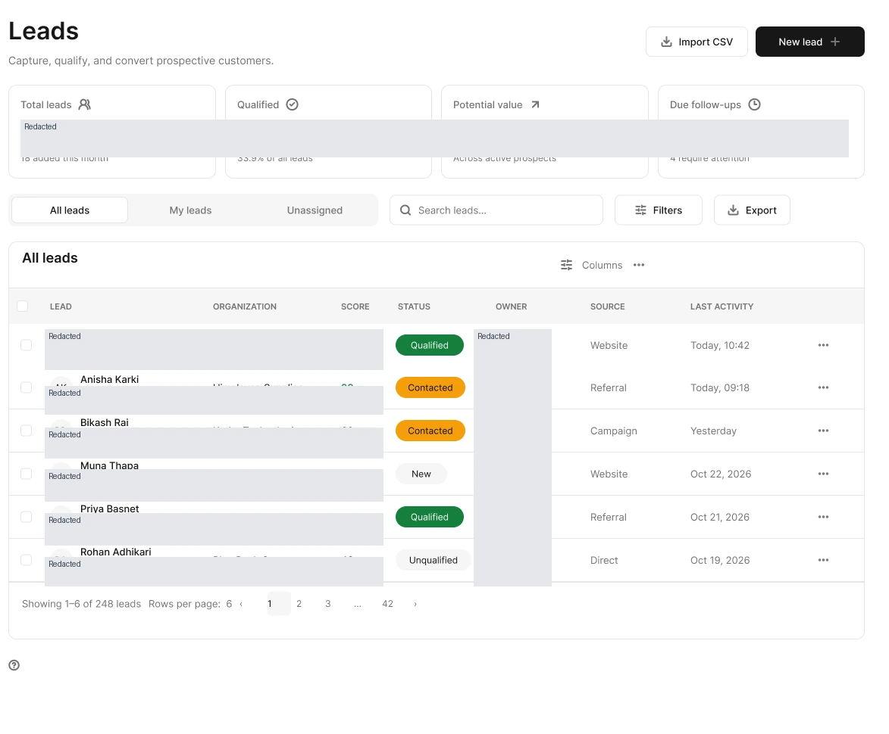
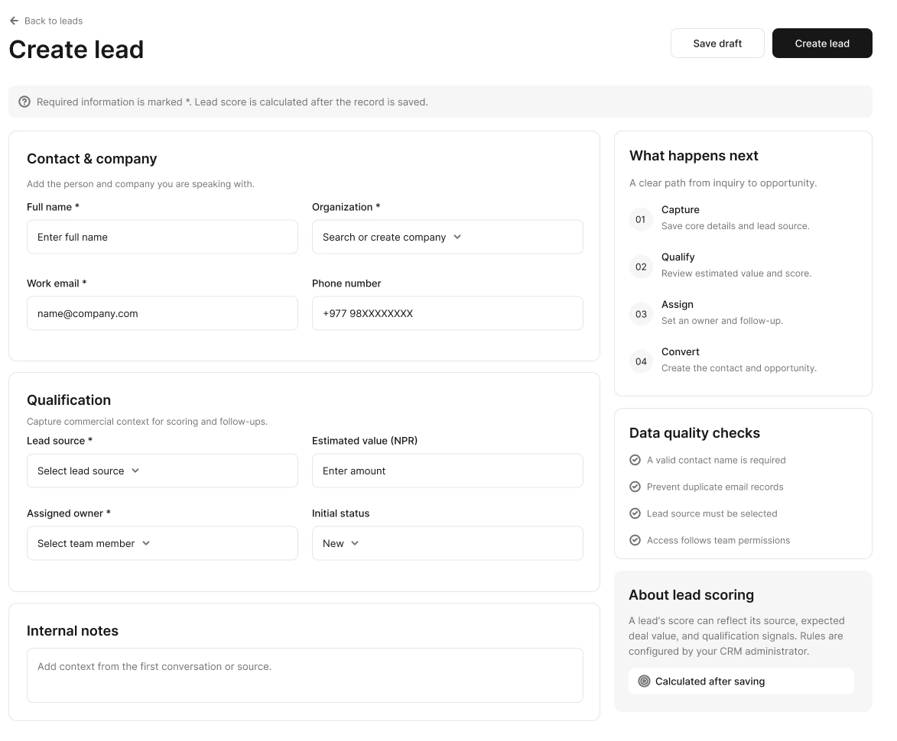
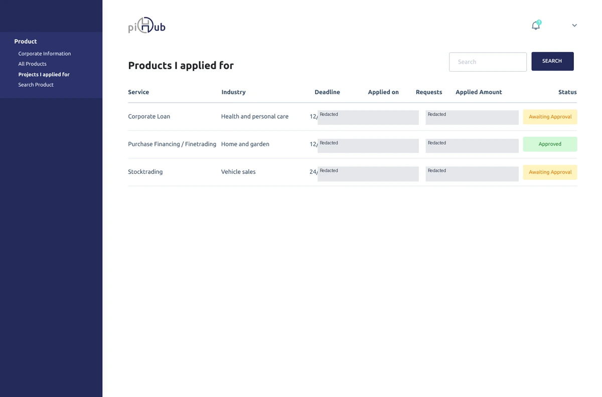
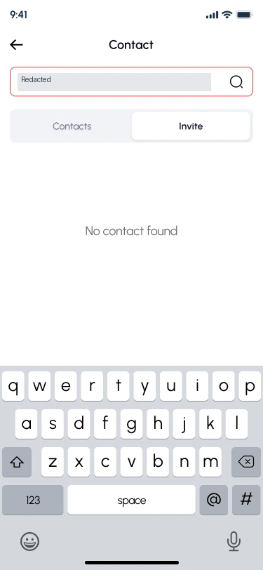
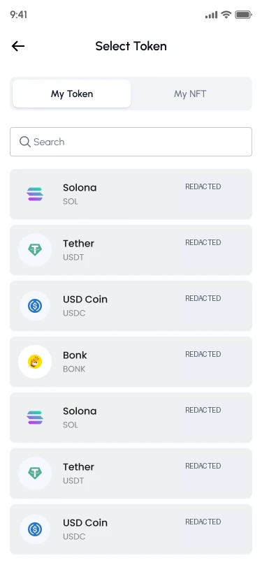
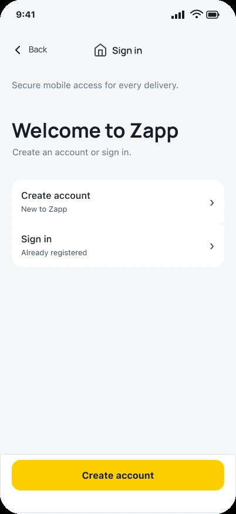
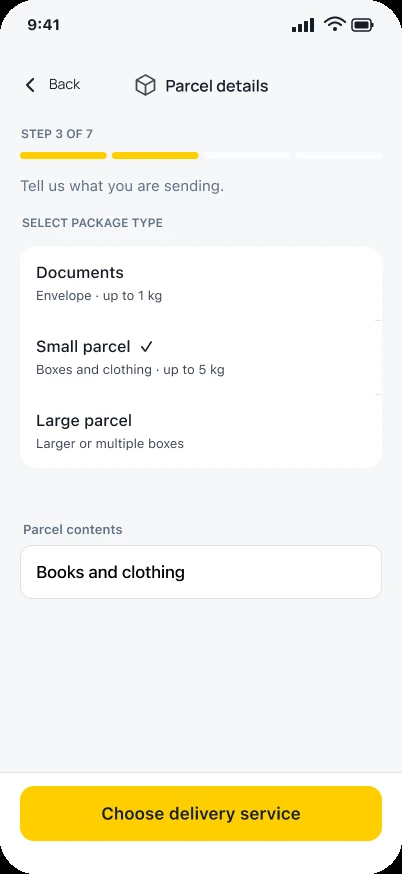
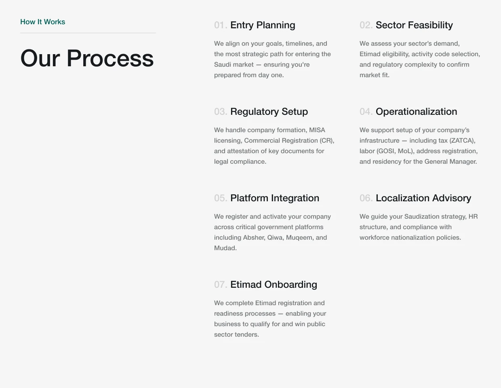

# Case-study copy review

Review snapshot of the authoritative JSON at code commit `00db48e`. This is proposed portfolio copy in PR #103, not a deployed website. Source images below are the reviewed local derivatives; raw originals remain private. Historical contribution statements are owner-supplied scope, not newly verified research or results.

## Orkest HQ

Enterprise SaaS · CRM and shared workspace patterns

Contribution: UX architecture and product design

A shared interface language for business software, with CRM screens that make ownership, qualification and the next action easier to inspect.

### Context and my contribution

Orkest brings CRM, sales, inventory and finance into a modular workspace. My challenge was to give that breadth a coherent structure without making every module behave like the same administrative table. A lead, an invoice and a stock movement can share navigation conventions while asking very different questions of the person using them.

My contribution covered the workspace architecture, navigation levels, record and table patterns, action hierarchy and information density. This case uses the current-labeled CRM frames in the supplied primary design file as its visual evidence. Other modules and draft states are part of the broader design context; they are not presented here as completed production features.

### Constraints

- Shared navigation must help people move between modules without erasing the task context.
- Dense record lists need enough structure for comparison, while creation and review need a clearer action hierarchy.
- A visible filter, view or button does not establish its implemented behavior or authorization rules.

### Separate ownership from record qualification

The leads design places All leads, My leads and Unassigned near search and Filters. These views describe ownership; qualification is represented inside the record list. Keeping those concepts separate gives a reviewer two useful questions: whose work is this, and what state is it in?

That separation also sets a handoff requirement. Switching an ownership view should have an explicit rule for existing filters, selection and the result count. The screenshot establishes the hierarchy, while the behavior still needs an agreed contract.

Curated CRM screen crop; record identities, organizations and summary values are redacted. Status labels and navigation are retained.

### Make dependencies visible before saving

The create-lead design groups contact information and qualification instead of scattering both across an undifferentiated form. Its side panel explains the capture-to-conversion sequence and says that the score is calculated after saving. That is a useful boundary: the interface should not imply that an unsaved value is already a reliable qualification result.

The remaining design-to-engineering questions are concrete: what may a draft omit, when is duplicate checking performed, who may assign an owner, and which values survive a failed save? Those questions belong beside this form rather than in a separate generic handoff document.

Curated crop of the current Orkest CRM create-lead design. This is design evidence, not a claim about a shipped feature or conversion results.

### Reuse grammar where the operational job repeats

The shared system is a set of rules for location, records, status and action priority. It should reduce relearning when someone moves from a list into a detail view. It should also permit an exception when a module needs a different sequence or a more consequential review step.

I would judge reuse by whether the next task remains understandable, not by counting identical cards. For CRM, that means keeping the record identity and owner legible while allowing qualification and conversion to receive their own treatment.

### Artifacts and delivery boundary

The useful handoff unit is a record workflow: entry conditions, data requirements, state changes and recovery, supported by reusable interface patterns. The reviewed exports show the visible design; they do not verify server validation, access control or synchronization between modules.

### What this work demonstrates

This work demonstrates how I structure a broad product before detailing individual screens. No adoption, revenue, conversion or task-time result is claimed. The next validation would ask people to locate an unassigned lead, explain its status, create a draft and recover from a rejected save.

### Related routes

- SaaS product design: /saas-ux-designer
- Role-based dashboard decisions: /blog/role-based-saas-dashboard-ux
- Operational filter UX: /blog/saas-dashboard-filter-ux

## piHub

Fintech · Creditor, investor and administrator journeys

Contribution: Product design contribution

Financial workflows organized around what has been submitted, who needs to act and what remains unresolved.

### Context and my contribution

piHub spans creditor, investor and administrative experiences. The recurring interaction problem is uncertainty: a person may have supplied information but still be waiting on verification, review or another party. A short status label is useful only when its meaning and the next available action are clear.

My existing portfolio scope covers applications, credit requests, verification, account management and dashboards. I worked on information hierarchy, forms, state language and the relationship between a process state and the action available to each role. The role prototypes are separate artifacts; they do not constitute a synchronized financial application.

### Constraints

- The same financial process is viewed by people with different tasks and permissions.
- Application data and sample financial values must not be mistaken for verified transactions or product results.
- A process can legitimately require waiting; the interface must explain that boundary rather than invent progress.

### Keep application state in the comparison view

The creditor screen places service, industry, timing and a text status in the same table. Approved and Awaiting Approval remain readable labels rather than color alone. Someone comparing applications can therefore inspect state without opening each record just to discover whether it is still under review.

The public derivative removes financial and identifying values. What remains is the information structure, which is the evidence relevant to this case. The image does not prove that an approval was genuine or that a process became faster.

Creditor application-list design. Dates, request counts and amounts are redacted; these rows are not reported business results.

### Share status language without flattening the roles

A creditor needs to understand an application they submitted. An investor needs a different view of opportunities and commitments. An administrator needs review context and permitted actions. The common element is the meaning of a state; the information priority should change with the job.

The source file separates these role journeys. In review, I would trace one example across them and check that Submitted, Reviewing and Approved have consistent meanings. A matched set of screens is a design model, not proof that cross-role updates or authorization are implemented.

### Give review and recovery their own requirements

A verification request should say what information needs attention and preserve what is already valid. A waiting state should identify the dependency when that information can safely be disclosed. An error should distinguish a correctable input problem from a service interruption.

Those are acceptance conditions for the workflow, not financial promises. They make the handoff discussion more useful than a blanket requirement to make the onboarding shorter.

### Artifacts and delivery boundary

I organize the discussion around role, current state, outstanding requirement and next action. The linked creditor, investor and admin prototypes provide paths for inspecting the design. Production permissions, uploads, persistence and real financial processing require separate engineering verification.

### What this work demonstrates

The case demonstrates multi-role information architecture and status-oriented fintech UX. I do not have a verified conversion or processing-time result to attach to it. Useful follow-up testing would ask each role to explain what is happening, who must act next and how an incomplete submission can be corrected.

### Related routes

- Review a complex product workflow: /ux-audit
- Separate views from permissions: /blog/role-based-saas-dashboard-ux
- Related enterprise workflow work: /project-orkest

## Yarsha

Mobile · Web3 messaging and wallet context

Contribution: Product design contribution

Keeping contact, asset selection and consequential actions understandable inside a conversational product.

### Context and my contribution

Yarsha combines messaging with Solana-related actions and bot interactions. A conversation encourages quick movement, while a wallet action needs a more deliberate check of intent and consequence. My design focus was the boundary between those behaviors, including the context a person needs before leaving a conversation to authorize an action.

The images here come from the file's Final Mobile Design page. That page label establishes the source version; it is not a claim that every frame is production-ready. The reviewed examples show contact search and token selection. They do not prove a completed transfer, network confirmation or the behavior of an external wallet.

### Constraints

- Wallet and network behavior extends beyond the messaging interface.
- Asset labels and transaction context must remain distinguishable from decorative chat content.
- Contacts, balances and identifiers in a design file may be sensitive even when they are sample content.

### Keep the search context when there is no match

The contact-search frame reports No contact found while retaining the query and keyboard. Contacts and Invite remain separate tabs. That makes the zero-result situation visible, but it also exposes an unanswered recovery question: should the person revise the query, clear it or invite someone?

I treat that question as part of the design review. The image supports a discussion of the existing state; it does not justify claiming that recovery has already been validated.

Final Mobile Design page: a contact-search empty state. The entered name is redacted. This screen supports a discussion of recovery options; it does not demonstrate a wallet transaction.

### Identify the asset before asking for an action

The token-selection design pairs the asset name with its symbol and separates tokens from NFTs. Search sits above the list. This gives the person a place to establish what they are acting on before a later review or wallet request.

Balance-like values are redacted in the public image. They are irrelevant to the interface argument and must not be presented as holdings, returns or evidence of product usage. A production review would still need to consider duplicate symbols, unavailable assets and ambiguous search results.

Source screen from Final Mobile Design. Balance and change values are redacted; asset names and symbols illustrate design structure, not holdings or investment information.

### Keep connection, review and authorization distinct

The broader interaction model separates selecting an action from authorizing it. A useful review would retain the originating conversation and explain the destination, asset and consequence in product language. Connecting a wallet should not silently stand in for consent to a later action.

The reviewed screenshots stop before that full sequence. Pending, rejection and resolved transaction behavior therefore remain validation questions here rather than illustrated completion claims.

### Artifacts and delivery boundary

The handoff discussion needs both screen structure and state rules: what context persists, what is controlled by the wallet, and how the product explains an unresolved outcome. Contact search and asset selection are inspectable artifacts; a complete transaction acceptance test must also exercise the wallet and network integration.

### What this work demonstrates

This case shows my approach to keeping familiar mobile interaction and higher-consequence actions in the same product. No financial-safety, transaction-success or conversion improvement is asserted. I would validate whether people can identify the chosen asset, explain the requested action and return to the conversation without losing context.

### Related routes

- Web3 product design: /web3-ux-designer
- Designing wallet connection: /blog/web3-wallet-connection-ux
- Transaction review decisions: /blog/transaction-review-ux-crypto-apps

## Zapp Today

Mobile logistics · Customer, driver and operations

Contribution: Mobile product design contribution

Different interfaces for people booking a delivery, carrying it out and resolving exceptions around it.

### Context and my contribution

A delivery creates shared state but different priorities. A customer needs to prepare a request and understand what happens next. A driver needs a clear operational task. An operations team needs the context required to investigate an exception. My existing project scope covers these related journeys, rather than one app screen in isolation.

This case uses the supplied Zapp 2.0 customer iOS file as its primary visual source. Historical customer and driver prototypes remain separately labeled. I have not combined those older screens with the newer design and presented the result as one approved release.

### Constraints

- Customer and driver priorities differ even when they refer to the same delivery.
- Maps, location, pricing and live tracking require real services; a prototype cannot establish their accuracy.
- The current source contains QA and experimental frames, which are withheld from the public illustration set.

### Make account entry an understandable choice

The account-entry frame distinguishes Create account from Sign in and gives each a short explanation. The primary action gives the new-customer path more emphasis without hiding the returning-user route.

That is a narrow but useful decision to inspect. It shows onboarding hierarchy, not evidence that registration became faster or that the full delivery service was implemented.

Customer iOS account-entry screen from the primary Zapp design file. It shows the design state, not evidence of delivery performance.

### Ask for parcel context at the point it matters

The parcel-details frame presents Documents, Small parcel and Large parcel with short descriptions, then asks for contents. Its visible step indicator places the task inside a longer request. The action says Choose delivery service, which tells the customer what the next screen is for.

This structure keeps package description separate from the choice of service. Before implementation, the team still needs rules for unsupported items, size limits, edited answers and validation. The screenshot shows the proposed sequence rather than proving those rules exist.

Customer iOS parcel-details frame from the supplied primary Zapp 2.0 file. This is a design state, not evidence of working pricing, dispatch or delivery.

### Review one lifecycle across the role boundaries

For the wider logistics model, the important consistency is the meaning of a delivery state. A role-specific screen can show a different amount of detail while still agreeing on whether the delivery is requested, assigned, underway or unresolved.

My review would follow the same delivery identifier through customer, driver and operations views, then test delay and reassignment. Those are explicit validation scenarios; separate prototypes do not demonstrate real-time synchronization or a functioning dispatch service.

### Artifacts and delivery boundary

The handoff needs a shared lifecycle, the actions available to each role and the information retained after an interruption. The current parcel and account screens provide concrete visual evidence. Live route calculation, delivery estimates, payments and operational permissions need independent integration tests.

### What this work demonstrates

The work demonstrates role-aware mobile information architecture and a booking sequence that can be discussed step by step. No delivery-volume, completion-rate or task-time result is claimed. The next useful test is a complete booking with an edited parcel answer, an unavailable service and a recoverable interruption.

### Related routes

- Mobile product design services: /services
- Review the full journey before redesigning: /blog/ux-audit-checklist-before-redesign
- Another multi-role product: /project-pihub

## Morajaa

B2B consulting · Service and sector website

Contribution: UX, content structure and website design contribution

Helping a prospective client move from a recognizable business problem to a specific consulting service and a useful conversation.

### Context and my contribution

Morajaa presents consulting services and sectors to visitors who may know their business problem before they know the consultancy's terminology. My contribution covered information architecture, service and sector page structure, responsive composition and inquiry paths.

The source for this case is the supplied Final Design v2 page. The reviewed example comes from the Market Entry in Saudi Arabia service design. It is a design artifact, not independent verification of the consultancy's legal claims, service performance or client results.

### Constraints

- Service and sector categories need to connect without making visitors read duplicate pages.
- Long-form explanation must remain scannable without reducing an involved service to a slogan.
- A page should communicate the consultancy's scope without turning the portfolio into a source of regulatory advice.

### Make the service concrete before asking for an inquiry

A consulting category becomes more useful when a visitor can see the work involved. The market-entry design moves from an introduction into setup services, ongoing support and a named process. That sequence gives the call to action more context than a standalone contact button.

My editorial priority is the relationship between those sections. The first scan should establish relevance; deeper reading should explain the scope and sequence well enough to support a more informed inquiry.

### Use a process section to reveal the shape of the engagement

The source design breaks the process into named stages, including entry planning, sector feasibility and operationalization. The stage titles carry the scan; supporting text supplies detail. A visitor can inspect the structure before committing to reading every paragraph.

The public crop isolates that information design and excludes photography and staff identities. The consultancy's process wording is shown as source content; the portfolio does not endorse it as legal or regulatory guidance.

Curated process-section crop from the supplied Final Design v2 service screen. Photography and staff details are outside this crop. Source service statements are not independently verified legal or commercial claims.

### Allow more than one sensible entry path

Services describe the kind of support offered, while sectors describe the visitor's operating context. Both can be useful routes into the same business. The design task is to connect them without forcing one taxonomy to stand in for the other.

On smaller screens, that relationship needs descriptive links and a deliberate reading order. Stacking a desktop layout is not enough if the explanation and its supporting action become separated.

### Artifacts and delivery boundary

The deliverable is an information structure and responsive visual system that can accommodate service depth. The linked prototype remains an interactive reference; the images here are readable crops of individual source screens. I have not treated every page on the file's canvas as approved marketing material.

### What this work demonstrates

The case demonstrates B2B content hierarchy and a service narrative that can support a qualified conversation. There is no verified inquiry-volume or commercial-performance result. The next validation would ask visitors to identify the relevant service, describe its scope and find the next useful step without a sales explanation.

### Related routes

- Website UX for complex services: /website-ux-design
- Writing a clearer service website: /blog/blog-service-websites
- Review website decision paths: /blog/website-ux-checklist-software-companies

## Masteriyo

WordPress LMS · Collaborative product design

Contribution: Product UI and UX contribution within a team

Designing authoring and learning interactions inside an established LMS, while keeping the contribution boundary clear.

### Context and my contribution

A course has several users. Its creator organizes topics, lessons, settings and questions. A learner needs orientation, feedback and a next step. An administrator needs oversight. Sharing a content model does not make those jobs interchangeable.

My existing portfolio records a contribution to course and quiz flows, learner states, hierarchy and reusable UI patterns within a larger product team. This is not a claim of sole ownership of Masteriyo, its design system or every screen in the Figma file.

### Constraints

- New work needs to fit the conventions of an existing WordPress learning product.
- Creator configuration and learner activity need different priorities.
- The newly supplied primary file and older copy must remain distinct; team reuse clearance for new screenshots is still pending.

### Keep authoring structure separate from learner progress

Creators need to understand how content is assembled and configured. Learners need to understand where they are and what they can do next. I approach those surfaces with different information priorities while retaining familiar controls and terminology where the underlying action is genuinely the same.

That avoids a misleading kind of consistency: two screens can look similar while requiring very different decisions. A shared component should not dictate the entire hierarchy of a role.

### Make complex configuration reviewable in parts

Course and quiz authoring contain related settings that become harder to reason about when presented as one uninterrupted form. Grouping them by purpose gives a creator a smaller set of decisions to inspect at a time.

The important trade-off is visibility. Progressive disclosure should reduce competing detail without making it difficult to discover a requirement or understand why an option is unavailable. That balance belongs in the interaction review, not just the final screen composition.

### Contribute in a way another designer can continue

In a team product, a coherent addition is more useful than a parallel visual language. My contribution needs to be understandable in terms of existing components, content patterns and state behavior, with exceptions called out rather than silently introduced.

The current primary file contains dashboard, quiz, frontend and checkout areas. Access to that file does not establish authorship of all of them. New source exports remain private until the team-use boundary is confirmed; the case retains its existing public preview and source reference.

### Artifacts and delivery boundary

The work is presented as a collaborative design contribution with an established product context. The primary Figma reference is retained, and the older copy is treated as a historical source. New team screenshots are withheld from this review's public asset set pending reuse clearance.

### What this work demonstrates

This case demonstrates how I reason about different roles within one product and contribute without overstating ownership. No learner-completion, adoption or authoring-time improvement is asserted. Follow-up evaluation would test a creator's course setup and a learner's next-action comprehension separately.

### Related routes

- Design-system contribution: /figma-design-systems
- Components and implementation constraints: /blog/blog-design-systems-front-end
- Handoff as shared understanding: /blog/blog-good-handoff

## Mokshya.io

Web3 protocol · Website communication

Contribution: Website UX and product communication contribution

A technical product story with an accessible first explanation and a deeper path for people evaluating the mechanism.

### Context and my contribution

Mokshya's website needs to serve visitors with different levels of technical knowledge. Someone encountering the product for the first time needs a useful mental model. A developer or evaluator needs enough specificity to investigate further. My contribution centered on information architecture, section sequence and responsive composition.

This case is about protocol-product communication on the website. It should not be read as proof that I designed a complete wallet, implemented the protocol or verified financial outcomes. The existing website preview provides visual context for this contribution.

### Constraints

- The first explanation must be readable without removing the technical distinctions that matter.
- Claims need nearby supporting material rather than generic trust language.
- Long sections must keep their reading order and relationship to evidence on smaller screens.

### Let the outcome establish relevance

I structure the opening around what the product makes possible before asking the visitor to learn its terminology. That gives technical detail a purpose: it answers a question the page has already helped the visitor form.

The trade-off is precision. A short statement should narrow the claim rather than replace an explanation with a sweeping Web3 promise. Where the mechanism matters, the next section must supply it.

### Connect the summary to deeper evaluation

An introductory path and a developer path can share one coherent story without requiring the same reading depth. The summary explains the proposition; deeper material exposes the mechanism and the evidence available to inspect.

This is a content-hierarchy decision rather than a measured finding about visitor behavior. I would test whether a newcomer can explain the offer and whether a technical evaluator can find the detail they need without reading the entire page.

### Preserve explanation and proof as a pair

A supporting artifact is most useful near the statement it helps assess. On mobile, I keep that relationship in the reading order instead of letting a desktop column arrangement separate the explanation from its supporting visual.

That requires reviewing actual headings, paragraph lengths and image behavior at narrow widths. A responsive page can fit the viewport while still telling its story in an unhelpful order.

### Artifacts and delivery boundary

The portfolio scope is the website's narrative structure, responsive hierarchy and interface composition. The retained website preview provides context; the contribution described here is the narrative structure and interface composition.

### What this work demonstrates

The work demonstrates technical information architecture and restraint in product communication. I do not have a verified visitor-comprehension or inquiry result to report. The next step would be a short first-impression review followed by a developer-information retrieval task.

### Related routes

- Website UX design: /website-ux-design
- Software website review: /blog/website-ux-checklist-software-companies
- Related content architecture work: /project-morajaa

## Designerex

Luxury fashion rental marketplace

Contribution: Design contribution within a broader marketplace

Balancing image-led fashion discovery with the stable rental information needed to compare listings.

### Context and my contribution

Designerex is presented in my existing portfolio as a luxury fashion rental marketplace. The interface has to support interest in a garment and practical evaluation of a rental. Photography can establish desire, but it cannot answer questions about size, availability or terms on its own.

My contribution is limited to browsing and listing patterns, visual hierarchy and the relationship between images and decision details. This case does not claim end-to-end ownership of the marketplace or a measured change in bookings. The account is limited to my part of the browsing and listing experience.

### Constraints

- Large photography needs to coexist with readable listing information.
- A comparison grid becomes harder to use when equivalent attributes change position or format.
- A team contribution must remain distinct from ownership of the whole product.

### Give the photograph and the metadata different jobs

The photograph is the entry point to the item. The repeated listing structure is what lets someone evaluate several items without reconstructing the information every time. I approach the card as a relationship between both, rather than choosing between a purely editorial tile and a specification-heavy product block.

The design trade-off is density. Adding every rental condition to a grid can obscure the garments, while removing every practical attribute pushes too much work into detail pages.

### Keep comparable information in comparable places

Stable labels and placement make the repeated pattern useful. A person should not have to inspect a different part of each card to find an equivalent rental attribute. The detail page can then carry the depth that would overfill the browse view.

A practical review would compare several listings with different image crops, long names and unavailable options. That is a proposed evaluation, not a claim that the current marketplace has passed it.

### Keep premium presentation out of the way of the task

Visual restraint helps the product remain the focus. Navigation, filtering and actions should support the catalogue instead of demanding their own performance. A quieter interaction convention can still express the brand through typography, spacing and image treatment.

I would inspect keyboard access, filter feedback and returning from a detail page alongside visual craft. A premium browse experience still needs a predictable route back to the person's previous context.

### Artifacts and delivery boundary

This is a scoped account of marketplace UI contribution. Existing public references are preserved. The public account stays within the contribution and artifacts I can describe without claiming ownership of the whole marketplace.

### What this work demonstrates

The work demonstrates comparison-oriented hierarchy inside an image-led marketplace. No rental conversion or browsing-speed result is asserted. The most useful next test would ask someone to compare a small set of plausible rentals and explain which details informed their choice.

### Related routes

- Website and marketplace UX: /website-ux-design
- Content variation in a catalogue: /project-zakra-furniture
- When polish hides a decision problem: /blog/beautiful-interface-poor-ux

## Splashnode

Technical platform · Website design and frontend

Contribution: Website designer and frontend contributor

Explaining content, device and data-management capabilities through a website whose design and implementation can inform each other.

### Context and my contribution

The existing project material describes Splashnode as a technical platform with content, device and data-management capabilities. The website's job is to help a prospective buyer understand where that platform fits before asking them to compare a long list of features.

My contribution spans website composition, capability explanation, responsive behavior and frontend implementation. This case concerns that website experience. It does not establish ownership of the underlying platform software or provide a verified commercial result.

### Constraints

- Technical capability needs enough explanation to be meaningful to a buyer.
- Use cases and feature detail must support each other without repeating the same claim.
- Implementation decisions need to preserve hierarchy under real content and viewport constraints.

### Translate a capability into a recognizable task

A feature name is only useful when the visitor can connect it to something they need to accomplish. I organize the story around the problem or use case first, then explain the capability that supports it.

That order helps distinguish an introductory promise from the detail needed for evaluation. It also sets an editorial check: if a paragraph could describe any technical platform, it needs a more specific task or a narrower claim.

### Keep the route to evaluation visible

The page should help a visitor decide whether to inspect more detail, view an example or make contact. Repeating the same high-pressure action after every section can interrupt that evaluation instead of supporting it.

I treat action placement as part of the information sequence. A call to action should follow enough context for the visitor to understand what the next step offers, without hiding that route until the end of a long page.

### Let the browser challenge the composition

Because my contribution includes frontend work, a layout can be reviewed with actual copy lengths, wrapping and navigation behavior. That feedback is useful while decisions are still easy to change.

The existing public preview is retained as evidence of the work's visual context. The implementation is part of the design discussion, rather than a separate downstream deliverable.

### Artifacts and delivery boundary

The scope joins website UX with implementation-aware composition. Responsive layout, section hierarchy and reusable frontend patterns are part of the same deliverable. Backend platform capability and operational reliability remain outside the evidence shown by this case.

### What this work demonstrates

This work demonstrates a design-to-frontend approach to a technical B2B website. No lead-volume or product-usage improvement is claimed. I would validate whether a visitor can identify a relevant use case, find its supporting detail and choose an appropriate next step.

### Related routes

- Technical website UX: /website-ux-design
- Service communication: /blog/blog-service-websites
- Another design-to-code website: /project-hamro-idea

## Grid Labs

Hosting and infrastructure · Static website

Contribution: Website and frontend design contribution

A hosting offer organized around service fit, plan comparison and a clear route to the next commercial step.

### Context and my contribution

Grid Labs is a hosting and infrastructure website in the existing portfolio. A prospective buyer needs to understand which service fits, how plans differ and what information is still required before choosing. Specifications matter, but a specification wall does not provide that sequence by itself.

My contribution covers commercial hierarchy, plan presentation, domain-search affordance, responsive layout and static frontend structure. The case is deliberately scoped to the website. A visible search field does not establish a functioning domain lookup, and a plan card does not prove provisioning or billing capability.

### Constraints

- Equivalent plan information needs a consistent order and unit.
- Narrow screens make side-by-side comparison difficult.
- The interface must remain honest about the difference between a static website and an operating service.

### Make plan differences easy to locate

I start with the attributes that change the decision between plans. Those should remain in a stable order so the visitor can compare rather than remember a previous card. Supporting technical detail can remain available without giving every specification equal emphasis.

The review needs realistic prices, units and billing periods. Where current commercial terms are not verified, the portfolio should discuss the comparison pattern instead of repeating potentially outdated offers.

### Treat mobile comparison as an information problem

Stacking plan cards preserves content but weakens direct comparison. A useful narrow layout needs stable headings, repeated attribute labels and a clear association between price, period and included capability.

I would test a person comparing two plans with one meaningful difference. If the answer depends on remembering an offscreen card, the layout needs a stronger comparison aid or a more concise set of decision attributes.

### Keep scope visible at the boundary of the site

A domain-search affordance can communicate a next step, but it must not imply a service the static implementation does not provide. Its actual destination and response behavior belong in the build review.

The same discipline applies to purchase calls to action. The website should establish what the visitor is continuing toward without inventing a complete account, checkout or hosting-management platform in the case study.

### Artifacts and delivery boundary

The deliverable is a commercial website and maintainable frontend structure. The public account stays focused on commercial hierarchy, responsive comparison and the limits of a static implementation.

### What this work demonstrates

The work demonstrates comparison hierarchy and scope discipline. It does not claim sales growth or a working infrastructure backend. A useful next validation would ask someone to explain a plan difference and identify the action that follows their choice.

### Related routes

- Website UX and implementation: /website-ux-design
- Website evaluation checklist: /blog/website-ux-checklist-software-companies
- Technical product storytelling: /project-splashnode

## Hamro Idea

Software studio · Brand, website and frontend

Contribution: Design and development contribution

Connecting a Nepal-based studio's positioning, services, project proof and contact path in one maintainable website.

### Context and my contribution

Hamro Idea needed a website that could explain a software studio's offer to a prospective client. The first design question was what a visitor should understand before making contact, not which visual treatment would make the homepage more dramatic.

My existing scope spans positioning, information architecture, responsive UI, reusable sections, semantic markup and frontend implementation. Working across design and code let me inspect the page with real content and adjust its composition before treating the layout as finished.

### Constraints

- Internal service names may not match the language a prospective client uses.
- A multi-page site needs repeated patterns without making every service sound identical.
- The design must tolerate real copy, image proportions and future content changes.

### Organize the offer around client questions

I structure a service page around fit: what problem the service addresses, what work it includes and what proof helps someone evaluate it. That makes the service architecture more useful than a list of internal disciplines.

The practical editorial test is whether a prospect can select a relevant service and explain why it fits. That is a proposed test, not a claim about measured lead quality.

### Keep project proof near the service explanation

A project example is most useful when it answers doubt created by the adjacent service claim. I prefer a small number of relevant examples over a detached wall of logos or repeated assertions of quality.

The existing website preview is retained in this case. Its role is to support the description of my website contribution, rather than stand in for a measured commercial result.

### Use implementation to test the reusable system

Real headings, longer service names and smaller screens expose problems that ideal artboards can hide. I use those conditions to review section spacing, reading order, navigation and the route to contact.

Reusable sections still need a clear content contract: what is required, what can be omitted and what happens when an image or description is longer than expected. Semantic markup and predictable structure support that contract; they do not guarantee ranking outcomes.

### Artifacts and delivery boundary

The work joins service information architecture with a static multi-page frontend. The useful handoff is not only a visual style: it includes section responsibilities, responsive rules and a content structure the site can keep using.

### What this work demonstrates

This case demonstrates design-to-code ownership within the recorded scope. No traffic, ranking or inquiry increase is asserted. I would evaluate service selection, proof discovery and contact comprehension before treating the website's commercial objectives as achieved.

### Related routes

- Website design and frontend thinking: /website-ux-design
- Working with a designer in Nepal: /product-design-nepal
- Clearer service websites: /blog/blog-service-websites

## Zakra Furniture

WordPress and Elementor · Furniture starter site

Contribution: Storefront UI and template design contribution

An image-led catalogue designed to remain coherent when real content replaces the demo.

### Context and my contribution

A furniture starter site has two users: the shopper browsing products and the site owner changing the catalogue. The initial composition needs to support both. An attractive demo that depends on identical image crops and short product names is a fragile template.

My existing contribution covers catalogue hierarchy, reusable storefront sections, product-card structure, typography, spacing and CMS-aware choices for WordPress and Elementor. This case does not establish ownership of the whole Zakra platform, a working inventory service or a completed ecommerce backend.

### Constraints

- Furniture photography varies in crop, visual weight and aspect ratio.
- Product names, category sizes and section counts change after the template is delivered.
- Site owners need editing freedom without having to redesign the page for every update.

### Give photography a predictable frame

The catalogue needs a repeatable image treatment so a mix of product photographs still reads as one system. The choice is a trade-off: a fixed crop can improve rhythm but remove part of a product, while an uncropped image can create uneven whitespace.

I would review both approaches with varied source images and decide according to the product category. The rule should be explicit rather than dependent on manually preparing every demo asset.

### Keep the product-card contract stable

Names, category cues and decision details need predictable placement. A shopper should not have to relearn a card because a product name wraps onto another line or an optional field is absent.

For a template, that means reviewing long names, missing images, different product counts and narrow layouts. Those cases are part of the design brief for reusable content, not exceptions to be hidden from the portfolio.

### Make editability part of the UX

A site owner needs to understand which sections can be repeated, removed or rearranged. Simple spacing and typography rules give the editor useful freedom while limiting accidental visual drift.

The work is therefore more than a single storefront screenshot. Its value lies in the rules that help a catalogue survive ordinary editing. Those rules need to be evaluated with varied catalogue content, rather than judged only against the demo composition.

### Artifacts and delivery boundary

The scope is a reusable starter-site interface and its content behavior. Existing public material is retained. The design discussion stays distinct from claims about checkout, stock accuracy, order fulfillment or sales performance.

### What this work demonstrates

The case demonstrates CMS-aware visual systems and content resilience. No conversion or maintenance-time improvement is claimed. The next validation would let a site owner replace the demo catalogue and inspect the result at narrow, medium and wide viewports.

### Related routes

- Reusable website UX: /website-ux-design
- Another image-led browsing problem: /project-designerex
- Content contracts for reusable UI: /blog/blog-design-systems-front-end

## Neverwinter Live Parser

Personal tooling · Combat-log information design

Contribution: Product design and frontend tooling

Turning an event stream into an inspectable summary without making clean numbers look more certain than the underlying data.

### Context and my contribution

A combat parser sits between raw events and a player's explanation of an encounter. The interface needs to group and summarize information while retaining enough context to judge what a number represents. A polished total is not useful if the player cannot tell which encounter, actor, filter or time range produced it.

My existing portfolio scope covers the information model, parser-facing UI, summary hierarchy and implementation-aware tooling. This is a personal technical project, not a claim to own Neverwinter or its game data. A verified Figma source is not required to explain code and information-design work.

### Constraints

- A summary depends on grouping and calculation assumptions that the interface must not conceal.
- Missing or ambiguous events can limit what may safely be inferred.
- High-density tables need useful defaults without preventing deeper inspection.

### Keep the summary attached to its context

Encounter, actor, time range and active filters change the meaning of a metric. I treat those as part of the information hierarchy rather than a separate configuration area someone must remember.

A review should be able to move from a summary to the events that support it. That is the evidence chain I want the interface to expose; the portfolio does not assert that every underlying calculation has been independently validated.

### Separate overview from diagnosis

An overview should help a player find a question worth investigating. A diagnostic view should help answer that question with more specific data. Giving every event equal prominence makes both jobs harder.

The trade-off is discoverability. Hiding detail is only useful when the route to it is clear and the summary does not imply a conclusion that the detail cannot support. Sort and filter labels need to make their effect understandable.

### Show uncertainty as a state of the data

A partial capture, an unknown value and a genuine zero should not collapse into the same visual result. They call for different interpretation and different next steps.

The useful implementation test uses a known input fixture and checks the visible result against the calculation contract. It should also include interrupted and repeated events. I do not convert this design principle into an invented accuracy or performance percentage.

### Artifacts and delivery boundary

The strongest proof for this kind of work is code, fixtures, calculation definitions and inspectable interface behavior. The public account is therefore centered on the information model and implementation questions rather than a gallery of conceptual screens.

### What this work demonstrates

The project demonstrates data-product thinking and attention to provenance. No verified parser-speed, damage-accuracy or player-performance improvement is claimed. The next evaluation would ask a player to explain a summary and then locate the event context behind that explanation.

### Related routes

- Gaming and interface clarity: /blog/blog-gaming-interface-clarity
- Reviewing dense dashboards: /blog/saas-dashboard-ux-checklist
- Related developer tooling: /project-sassboilerplate

## SassBoilerplate

Frontend utility · Style architecture

Contribution: Frontend creator

A small Sass starter that makes file responsibilities predictable without turning setup into a framework of its own.

### Context and my contribution

A starter is useful when it removes repeated decisions and remains easy to change. It becomes a cost when a developer has to learn hidden conventions before doing the actual work. SassBoilerplate is a deliberately modest developer-experience project around that boundary.

My existing scope covers Sass structure, file responsibilities, naming and workflow documentation for small frontend projects. It is code-oriented work. I do not present a fabricated Figma interface as evidence of a style architecture.

### Constraints

- A small project should not inherit abstractions it is unlikely to use.
- Import order and naming need to be understandable to someone who did not create the starter.
- The structure should be cheap to shrink, replace or remove as a project changes.

### Make responsibility easier to locate

A folder name earns its place when it helps answer where a change belongs. I prefer a structure that separates broadly shared decisions from component-specific styling without requiring a long verbal explanation.

The test is practical: can another developer locate a type rule, a layout rule and a component rule from the names and imports? That is a validation task, not a measured onboarding result.

### Keep the dependency direction legible

A starter should make it possible to understand what depends on what. Hidden coupling makes an apparently local style change difficult to reason about and increases the cost of deleting unused code.

I treat import structure and documentation as part of the product interface for a developer. The aim is not the largest possible file tree; it is a small set of conventions that correspond to actual responsibilities.

### Make removal a normal use case

A team may adopt only part of a starter or outgrow its original assumptions. Loosely coupled conventions are useful because they can be replaced without preserving the entire setup indefinitely.

That restraint is the design decision this case is meant to show. It does not imply that every frontend project needs the same architecture or that Sass is the correct choice for every team.

### Artifacts and delivery boundary

The deliverable is the structure and the explanation that makes it usable. Repository evidence is more relevant here than a screenshot. Existing code references are preserved; their current maintenance and compatibility still need to be assessed before adopting the utility in a new project.

### What this work demonstrates

The project demonstrates developer-experience thinking and a preference for explicit responsibilities. I do not have a verified setup-time reduction to report. A useful evaluation would ask another developer to change a shared token, add a component and remove an unused layer without help from the author.

### Related routes

- Design-to-implementation systems: /figma-design-systems
- Design systems and frontend responsibilities: /blog/blog-design-systems-front-end
- Related personal tooling: /project-neverwinter-parser
